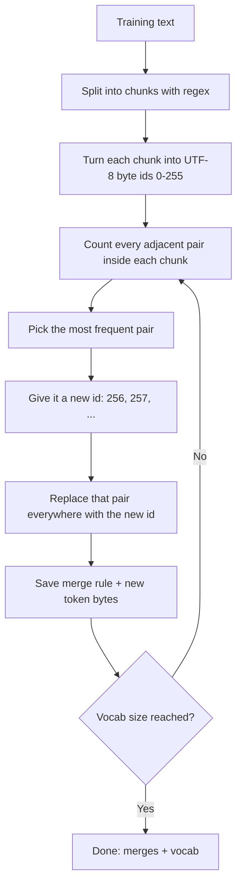
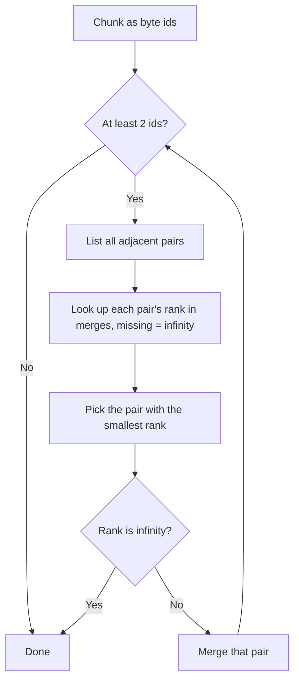
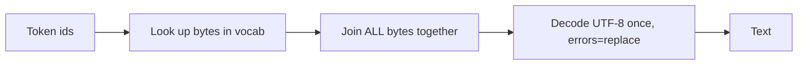

# Day 2: How LLMs Work 1 — Tokens & Tokenization 🔢

**Date:** 11 Nov 2026
**Notebook:** [`notebooks/day02/tokens.ipynb`](../notebooks/day02/tokens.ipynb)

> **Goal:** Understand how text becomes tokens, build a byte-level BPE tokenizer from scratch, and measure how many tokens different languages cost.

---

## 🎯 What I did today

- Learned what tokens are and why cost, latency and context limits are counted in tokens
- Learned how UTF-8 stores text as bytes, down to the binary level
- Worked through BPE training and encoding by hand on a small example
- Watched the first half of Karpathy's *"Let's build the GPT Tokenizer"*
- Built my own **byte-level BPE tokenizer** in Python: train, encode (two ways), decode
- Added **regex pre-tokenization** so merges never cross word boundaries
- Compared token counts for English, Hinglish, Hindi and Python code using real tokenizers (GPT-4, GPT-4o, Qwen2.5)

---

## 1. What is a token? 🧩

A model does not read words or letters. It reads **tokens**: small chunks of text, each mapped to an integer ID.

```
"Hello Mayank, how are you?"
→ [Hello] [ May] [ank] [,] [ how] [ are] [ you] [?]
→ [9906, 3297, 1201, 11, 1268, 527, 499, 30]   (example IDs)
```

**Why tokens matter:**

| Area | Why tokens decide it |
|------|---------------------|
| 💰 **Cost** | APIs charge per token (input and output) |
| 📏 **Context window** | A model can only read a fixed number of tokens at once |
| ⏱️ **Rate limits** | Free tiers limit tokens per minute (error `429`) |
| ⚡ **Latency** | More output tokens = slower answers |

Rough rule for English: **1 token ≈ ¾ of a word**.

---

## 2. Text → bytes (UTF-8) 💾

Computers store text as **bytes** (numbers 0–255). UTF-8 is the rule for turning characters into bytes.

### Bytes per character

| Character | Bytes | Count |
|-----------|-------|-------|
| `a` | `[97]` | 1 |
| space | `[32]` | 1 |
| `क` | `[224, 164, 149]` | **3** |
| `ा` (matra) | `[224, 164, 190]` | **3** |
| `😄` | `[240, 159, 152, 132]` | **4** |

➡️ Every Devanagari character costs **3 bytes**, English costs **1**. This is the root of Hindi token inflation.

### UTF-8 labels: the first bits tell the story

| Byte starts with | Meaning |
|------------------|---------|
| `0xxxxxxx` | A complete 1-byte character (ASCII / English) |
| `110xxxxx` | Start of a 2-byte character |
| `1110xxxx` | Start of a 3-byte character (Hindi) |
| `11110xxx` | Start of a 4-byte character (emoji) |
| `10xxxxxx` | Continuation byte (middle or end of a character) |

### Worked example: how `क` is stored

```
क = Unicode code point U+0915 = 2325
2325 in binary (16 bits) = 0000 1001 0001 0101

3-byte template:   1110xxxx   10xxxxxx   10xxxxxx
Split the bits:        0000 |   100100 |   010101

Byte 1: 1110 + 0000    = 11100000 = 224
Byte 2: 10   + 100100  = 10100100 = 164
Byte 3: 10   + 010101  = 10010101 = 149
```

### Reading binary

```
Place values:  128  64  32  16   8   4   2   1
h = 104     =   0    1   1   0   1   0   0   0   → 64 + 32 + 8 = 104
```

### Decoding half a character

```python
bytes([224]).decode("utf-8")  # ❌ unexpected end of data
bytes([128]).decode("utf-8")  # ❌ invalid start byte
bytes([224, 164]).decode("utf-8", errors="replace")  # '�'
bytes([224, 164, 149]).decode("utf-8")  # 'क' ✅
```

| `errors=` | What happens with broken bytes |
|-----------|-------------------------------|
| `"strict"` (default) | Crash |
| `"replace"` | Insert `�` (safe and visible) ✅ |
| `"ignore"` | Silently drop them (dangerous) |

---

## 3. BPE training (Byte-Pair Encoding) 🏋️

### The algorithm



Key points:
- Start from **256 byte tokens**, so nothing is ever "unknown"
- After every merge, the text changes, so **pairs are counted again**
- Merge **order = priority** (rank 1 is the first merge learned)
- Stop when the vocab reaches the chosen size (`vocab_size - 256` merges)

### Worked example (by hand)

Corpus: `low ×5`, `lower ×2`, `newest ×6`, `widest ×3`

**Merge 1 — count pairs (weighted by word frequency):**

| Pair | Where | Count |
|------|-------|-------|
| `e s` | newest (6) + widest (3) | **9** 🏆 |
| `s t` | newest (6) + widest (3) | 9 |
| `w e` | lower (2) + newest (6) | 8 |
| `l o`, `o w` | low (5) + lower (2) | 7 |
| `n e`, `e w` | newest (6) | 6 |

**Merge list after 7 merges:**

```
1.  e   + s    → es
2.  es  + t    → est
3.  l   + o    → lo
4.  lo  + w    → low
5.  n   + e    → ne
6.  ne  + w    → new
7.  new + est  → newest
```

Final words: `low` → `[low]`, `newest` → `[newest]`, `widest` → `[w][i][d][est]`

BPE discovered the common English ending `est` on its own. 🤯

---

## 4. Encoding (text → token ids) ✂️

Encoding must split text **the same way as training** (same regex), then apply the learned merges.

### Way A: apply every rule in order (my approach)

```
for each merge rule (rank 1, 2, 3, ...):
    replace that pair in every word
```

Simple and correct, but checks **every** rule, even ones that cannot match.

### Way B: Karpathy's approach (lowest rank first)



### Dry run: `" lowest"` (Way B)

Merges used: `256 = es`, `257 = est`, `258 = lo`, `259 = low`, `260 = ␣low`

| Round | Pairs with a rank | Winner | Result |
|-------|------------------|--------|--------|
| 1 | `lo`=258, `es`=256 | **256** | `␣ l o w [es] t` |
| 2 | `lo`=258, `es+t`=257 | **257** | `␣ l o w [est]` |
| 3 | `lo`=258 | **258** | `␣ [lo] w [est]` |
| 4 | `lo+w`=259 | **259** | `␣ [low] [est]` |
| 5 | `␣+low`=260 | **260** | `[␣low] [est]` |
| 6 | none (all ∞) | stop 🛑 | `[260, 257]` |

Result: `" lowest"` → `[b' low', b'est']`, a word that was **never in training**, split into meaningful pieces.

### Way A vs Way B

| | Way A | Way B |
|---|---|---|
| Work per chunk | Every merge rule | Only pairs present |
| With 100k+ rules (GPT) | Slow 🐢 | Fast 🚀 |
| Result | Same ✅ | Same ✅ |

---

## 5. Decoding (token ids → text) 🔙



**Rule: join first, decode once.**

A single token can hold **half a character**. For example, BPE can merge the last byte of one `क` with the first byte of the next one. Alone it decodes to `��`, but after joining all bytes the text is perfect:

```
Tokens:  [224, 164, 256, 164, 149]      (256 = b'\x95\xe0')
Bytes:   e0 + a4 + 95e0 + a4 + 95
Joined:  e0 a4 95 e0 a4 95  →  "कक" ✅
```

That is why `vocab` stores **bytes**, not text. Decoding a piece too early would destroy information forever.

⚠️ **Streaming apps** (showing tokens one by one) must **buffer** incomplete bytes until a full character arrives.

---

## 6. Regex pre-tokenization ✂️

### The problem without regex

BPE only sees numbers, not words. On `"newest newest"` it learned `est␣` (with the space), and then started counting `est␣` + `n` across **two different words**. More merges would create junk tokens like `est n`:

- No real meaning, only a coincidence of this text
- Wastes vocab slots
- The same word gets different tokens depending on its neighbour

### The fix: split first, then BPE inside each chunk

```python
SPLIT_PATTERN = r" ?[^\s.,!?]+| ?[.,!?]+|\s+"
```

| Piece | Meaning |
|-------|---------|
| ` ?` | An optional space (`?` outside brackets = optional) |
| `[^\s.,!?]+` | One or more characters that are **not** space or punctuation |
| `[.,!?]+` | One or more punctuation marks (`?` inside brackets = a real question mark) |
| `\s+` | Leftover spaces or newlines |
| `\|` | OR: try options in order |

```
"hi there! how?"  →  ['hi', ' there', '!', ' how', '?']
"मैं ठीक हूँ, तुम?" →  ['मैं', ' ठीक', ' हूँ', ',', ' तुम', '?']
```

The space sticks to the **front** of a word (`" low"`), just like GPT tokens.

---

## 7. My tokenizer: results 🧪

**Functions built:** `get_stats`, `merge`, `train_bpe` (with regex), `encode_a`, `encode_b`, `decode`

**Run without regex (10 merges, same corpus as the hand example):**

```
Merge 1: (101, 115) -> 256  b'es'    (9 times)   ✅ matches the hand example
Merge 2: (256, 116) -> 257  b'est'   (9 times)   ✅ matches the hand example
Merge 3: (257, 32)  -> 258  b'est '  (8 times)   ← space got merged in
Merge 4: (108, 111) -> 259  b'lo'
Merge 5: (259, 119) -> 260  b'low'
Merge 6: (32, 260)  -> 261  b' low'
...
Length: 94 → 27 tokens (71% fewer)
```

With regex, tokens like `est␣` disappear and merges stay inside words. The text needs a few more tokens, but every token is meaningful.

Checks: `decode(encode(text)) == text` ✅ and Way A == Way B ✅

---

## 8. Concepts 🧠

### Vocab size trade-off

| Bigger vocab | Smaller vocab |
|--------------|---------------|
| ✅ Fewer tokens per text (cheaper, more fits in context) | ✅ Smaller embedding table |
| ❌ Bigger embedding table and output layer (`vocab_size × d_model`) | ❌ More tokens per text |
| ❌ Rare tokens get little training | |

### BPE vs Unigram vs WordPiece

| | BPE | Unigram | WordPiece |
|---|---|---|---|
| Training | Start small, **add** merges ⬆️ | Start big, **remove** tokens ⬇️ | Like BPE, different merge score |
| Encoding | Apply merges by rank | Best split by probability (**Viterbi**) | Longest match |
| Used by | GPT-2/4/4o, Llama 3 | T5, ALBERT (SentencePiece) | BERT |

### Special tokens

Tokens with a special job, added outside BPE: `BOS` (start), `EOS` (end), `PAD` (filler, attention mask = 0), chat roles (`system`, `user`, `assistant`). A user typing `<|endoftext|>` as plain text must **not** become the special token, so tiktoken raises an error on it by default.

### Real GPT tokenizers

GPT tokenizers use the **same byte-level BPE** I built, plus:
- A much bigger training corpus and vocab (~100k for GPT-4, ~200k for GPT-4o)
- A smarter regex (contractions, numbers split into short chunks, whitespace rules)
- Special tokens
- A fast Rust implementation (tiktoken), using Way B encoding

---

## 9. Token count comparison 📊

| Text | Words | Bytes | GPT-4 | GPT-4o | Qwen2.5 |
|------|-------|-------|-------|--------|---------|
| English | 15 | 81 | 17 | 17 | 17 |
| Hinglish | 18 | 105 | 31 | 29 | 31 |
| Hindi | 18 | 222 | 92 | 24 | 86 |
| Python code | 4 | 62 | 13 | 13 | 13 |

Tokens compared to English (1.00x = same as English):
  - English       GPT-4: 1.00x  GPT-4o: 1.00x  Qwen2.5: 1.00x
  - Hinglish      GPT-4: 1.82x  GPT-4o: 1.71x  Qwen2.5: 1.82x
  - Hindi         GPT-4: 5.41x  GPT-4o: 1.41x  Qwen2.5: 5.06x
  - Python code   GPT-4: 0.76x  GPT-4o: 0.76x  Qwen2.5: 0.76x

**Day 1 reference (Gemini `count_tokens`):** English 12, Hindi 14, Hinglish 15 tokens for a short sentence.

---

## 10. Python I learned along the way 🐍

| Code | Meaning |
|------|---------|
| `text.encode("utf-8")` | Text → bytes |
| `data.decode("utf-8", errors="replace")` | Bytes → text, safe |
| `list(data)` | Bytes are already integers inside; `list()` just puts them in a list |
| `bytes([104])` vs `bytes(104)` | One byte with value 104 vs **104 zero bytes** ⚠️ |
| `b"".join(pieces)` | Glue byte pieces together |
| `zip(ids, ids[1:])` | Adjacent pairs |
| `counts.get(pair, 0) + 1` | Count with a default of 0 |
| `max(stats, key=stats.get)` | Key with the biggest value (ties keep the first) |
| `min(stats, key=lambda p: merges.get(p, float("inf")))` | Pair with the smallest rank, missing pairs = infinity |
| `a.append(x)` vs `a.extend(x)` | Add one item vs add every item of a list |
| `type(x)`, `list(x)` | Remove Python's display "make-up" and see the real thing |
| `f"{b:08b}"` | Show a number as 8-bit binary |

**Notebook lessons:** re-run a cell after editing it, run cells in order, and use **Restart + Run All** when confused.

---

## 🐛 Problems I faced (and how I fixed them)

| Problem | Fix |
|---------|-----|
| Notebook cursor felt strange | Learned edit mode (click inside / `Enter`) vs command mode (`Esc`) |
| Added `print` inside a function, nothing printed | Re-ran the cell so the new version loaded into memory |
| Decoding bytes 128–255 one by one crashed | They are partial UTF-8 bytes; used `errors="replace"` |
| `vocab` showed letters, looked like text | It is bytes; Python prints ASCII bytes as letters (`b'es'`) |
| `encode_a` returned a list of lists | Flattened words with `.extend()` at the end |
| Called `decode` before defining it | Defined it in the final tokenizer cell |
| Ruff "files were modified" on commit | `git add` the fixed file, then commit again |

---

## 💡 3 Takeaways

1. 👉 *(Fill from Cell J2: how many times more tokens Hindi needs than English on GPT-4.)*
2. 👉 *(Fill from Cell J2: how much the bigger GPT-4o vocab narrows the gap.)*
3. GPT tokenizers are the same byte-level BPE I built from scratch; the differences are scale, regex and speed. **Measure tokens, don't assume.**

---

## 🎤 Interview-ready answers

- **What is BPE?** Start from 256 bytes, repeatedly merge the most frequent adjacent pair into a new token until the vocab is full. Encode by applying merges in rank order.
- **Why byte-level?** Every possible text is just bytes, so there is never an unknown token.
- **Why regex before BPE?** So merges stay inside words and the vocab is not wasted on cross-word junk.
- **Why does Hindi cost more tokens?** Each Devanagari character is 3 UTF-8 bytes, and tokenizers are trained mostly on English, so fewer Hindi merges are learned.
- **Why is the vocab bytes, not text?** A token can contain half a character; join all bytes first, then decode once.

---

## ⏭️ Next

- Write Way B encoding myself, without help
- Day 3: embeddings and self-attention (NumPy, heatmaps)
- Solve the single-head vs multi-head attention numericals