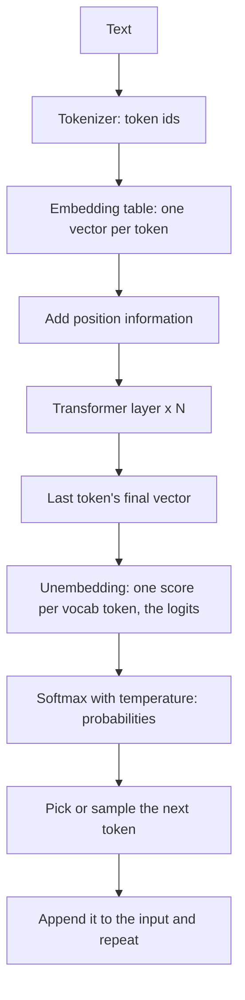
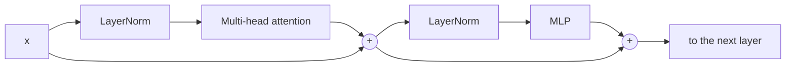
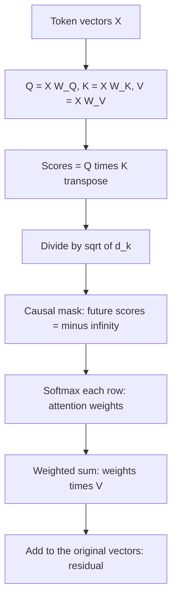
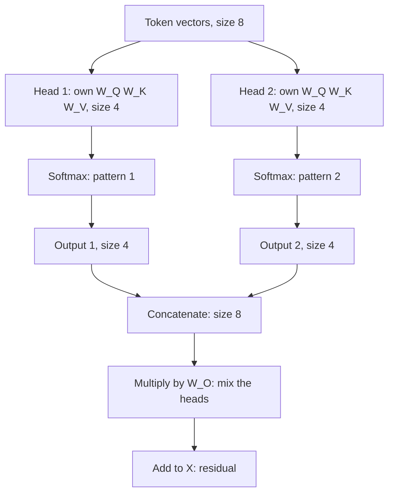

# Day 3: How LLMs Work 2 — Embeddings & Self-Attention 👀

**Date:** 12 Nov 2026
**Notebooks:**
- [`notebooks/day03/single_head_attention.ipynb`](../notebooks/day03/single_head_attention.ipynb)
- [`notebooks/day03/multi_head_attention.ipynb`](../notebooks/day03/multi_head_attention.ipynb)

> **Goal:** Understand how a transformer turns token ids into meaning, and build causal self-attention (single-head and multi-head) from scratch in NumPy.

---

## 🎯 What I did today

- Revised the math behind attention: dot product, matrix multiplication, softmax
- Watched 3Blue1Brown's GPT and attention chapters, read The Illustrated Transformer
- Learned embeddings, positional encoding, RoPE, Q/K/V, causal mask, multi-head attention, residual connections, LayerNorm and the MLP block
- Built **single-head causal self-attention** in NumPy, plotted the attention heatmap, and compared **with vs without √dₖ scaling**
- Built **multi-head attention** (2 heads), compared what each head looks at, then concatenated, mixed with W_O and added the residual

---

## 1. The big picture: how GPT predicts the next token 🗺️



**One transformer layer:**



```
x = x + Attention(LayerNorm(x))
x = x + MLP(LayerNorm(x))
```

- The vector size stays the same (`d_model`) through every layer, so the `+` (residual) always works.
- GPT-3 numbers: `d_model = 12,288`, `96 layers`, `96 heads` per layer.
- Generation is **autoregressive**: each new token is added to the input and the whole process runs again until an end token.

---

## 2. Math foundations 🧮

### Dot product: "how similar are two vectors?"

```
a = [1, 2, 3],  b = [4, 5, 6]
a · b = 1×4 + 2×5 + 3×6 = 32
```

| Dot product | Meaning |
|-------------|---------|
| Large positive | Similar direction |
| Zero | Unrelated (90°) |
| Negative | Opposite directions |

It also grows with the **length** of the vectors: `a · b = |a| × |b| × cos(angle)`. Cosine similarity removes length and keeps only direction.

### Matrix multiplication = many dot products at once

```
(a × b) @ (b × c) = (a × c)      the inner sizes must match
```

Every cell of the result is one row · one column. GPUs compute thousands of them in parallel, which is why transformers use matrices instead of loops.

### Softmax: scores → probabilities

```
softmax(z)ᵢ = e^(zᵢ) / Σ e^(zⱼ)
```

Worked example, `z = [2, 1, 0]`:

```
e² = 7.39,  e¹ = 2.72,  e⁰ = 1.00     sum = 11.11
→ [0.665, 0.245, 0.090]               (adds up to 1)
```

- Keeps the order, makes every value positive, and **amplifies gaps**: a gap of 1 becomes ~2.7×.
- `e^(-∞) = 0`, which is how masking works.

### Temperature

```
softmax(logits / T)
```

| T | z = [2, 1, 0] becomes | Shape | Use for |
|---|----------------------|-------|---------|
| 0.5 | [0.867, 0.117, 0.016] | Sharp | Code, facts, JSON, **agents / tool calls** |
| 1.0 | [0.665, 0.245, 0.090] | Normal | |
| 2.0 | [0.506, 0.307, 0.186] | Flat | Stories, brainstorming |

Temperature is a setting we choose per request, not something the model learns.

---

## 3. Embeddings 📦

- One **embedding table** of shape `vocab_size × d_model`. A token id is just a **row number**.
- Values start random and are **learned** in training. Single dimensions have no human labels; meaning lives in **directions**.
- Famous example: `king − man + woman ≈ queen` (the "man → woman" direction encodes gender).
- The table lookup has **no context**: "bank" gets the same vector in "river bank" and "SBI bank". Attention fixes that.

---

## 4. Position: why attention needs it 📍

Attention only compares pairs of tokens (`q · k`). Shuffle the words and every pair score stays the same, so on its own attention sees a **bag of words**. But *"dog bites man"* ≠ *"man bites dog"*.

**Sinusoidal / learned positions:** add a position vector to the token vector once, at the start.

```
input = token_embedding + position_vector
```

**RoPE (Rotary Position Embedding):** rotate **Q and K** in every layer by an angle that depends on the position. The vector is split into pairs, and each pair rotates at a different speed (like clock hands: fast pairs see nearby detail, slow pairs see long distances).

> **RoPE in one line:** rotating Q and K by their positions makes `q · k` depend only on the **relative distance** between the two tokens.

---

## 5. Self-attention, step by step 🔍

### Q, K, V

| | Meaning | YouTube analogy |
|---|---------|-----------------|
| **Query** | What this token is looking for | Your search text |
| **Key** | What this token offers | A video's title and tags |
| **Value** | The information this token gives | The video's content |

```
Q = X @ W_Q      K = X @ W_K      V = X @ W_V
```

`W_Q`, `W_K`, `W_V` are **learned matrices**. Every token gets its own q, k, v **vectors**.

> **Q · K decides HOW MUCH attention. V decides WHAT information flows.**

### The formula

```
Attention(Q, K, V) = softmax( Q·Kᵀ / √dₖ + mask ) · V
```



### Worked example (solved by hand) ✍️

3 tokens, `dₖ = 2`:

```
        Q          K          V
T1   [1, 0]     [1, 0]     [1, 0]
T2   [0, 1]     [1, 1]     [0, 1]
T3   [1, 1]     [0, 1]     [1, 1]
```

**Step 1 — Scores `Q · Kᵀ`** (row = who is looking, column = who is looked at):

```
          T1    T2    T3
T1    [   1     1     0  ]      q1·k1 = 1×1 + 0×0 = 1, ...
T2    [   0     1     1  ]
T3    [   1     2     1  ]
```

**Step 2 — Divide by √dₖ = √2 ≈ 1.414:**

```
T1    [ 0.71  0.71  0.00 ]
T2    [ 0.00  0.71  0.71 ]
T3    [ 0.71  1.41  0.71 ]
```

**Step 3 — Causal mask** (`j > i` → −∞):

```
T1    [ 0.71   -∞    -∞  ]
T2    [ 0.00  0.71   -∞  ]
T3    [ 0.71  1.41  0.71 ]
```

**Step 4 — Softmax each row:**

```
T1:  [1.00, 0, 0]                                  only itself
T2:  e⁰ = 1, e^0.71 = 2.03, sum = 3.03   → [0.33, 0.67, 0]
T3:  2.03, 4.11, 2.03, sum = 8.17        → [0.25, 0.50, 0.25]
```

**Step 5 — Weighted sum of values:**

```
T1:  1.00×[1,0]                              = [1.00, 0.00]
T2:  0.33×[1,0] + 0.67×[0,1]                 = [0.33, 0.67]
T3:  0.25×[1,0] + 0.50×[0,1] + 0.25×[1,1]    = [0.50, 0.75]
```

Each output is a **mix** of the value vectors it was allowed to see. This is a **weighted sum** (number × vector, then add), not a dot product.

**Same row T3 without scaling:** scores `[1, 2, 1]` → softmax `[0.21, 0.58, 0.21]`. Already more peaked; with real dimensions (dₖ = 64 or 128) the gap becomes huge.

### Causal mask

```
          I     love  learning  AI
I       [ ✓      ✗       ✗       ✗ ]
love    [ ✓      ✓       ✗       ✗ ]
learning[ ✓      ✓       ✓       ✗ ]
AI      [ ✓      ✓       ✓       ✓ ]
```

- A token sees itself and the past, never the future (`e^(-∞) = 0`, exactly zero).
- **Why in training:** the whole sentence goes in at once. Without the mask, each position could just look ahead and **copy the next word**. Training loss would look perfect, but the model would learn nothing useful for generating text.
- It also lets every position be trained **in parallel** without cheating.

### Why divide by √dₖ?

- A dot product adds up `dₖ` numbers, so its spread grows like **√dₖ**.
- Large scores → softmax becomes **almost one-hot** → each token copies a single value vector, and **gradients vanish**, so W_Q and W_K stop learning.
- Dividing by √dₖ brings scores back to around 1. It works like a fixed **temperature**.

---

## 6. Multi-head attention 🧠🧠

**Idea:** instead of one big head, use several smaller heads. Each head has its **own** W_Q, W_K, W_V, so it asks a different question and can focus on different tokens.



**Shapes (my toy example):**

| Step | Shape |
|------|-------|
| X | (4 tokens, 8) |
| Each head's W_Q, W_K, W_V | (8, 4) |
| Each head's output | (4, 4) |
| Concatenated | (4, 8) |
| After W_O and residual | (4, 8), same as X |

- `dₖ = d_model / n_heads` (8 / 2 = 4; GPT-3: 12,288 / 96 = 128).
- Each head still reads the **full** token vector; its matrix just produces a smaller summary. Nothing is sliced.
- **Same cost as one big head:** single head `3 × (8×8) = 192` weights; two heads `2 × 3 × (8×4) = 192`.

**Why not one big head?** One softmax per token means 100% of attention is split once, so it blurs several relations together. Multiple heads give each relation its own 100%.

```
"Rahul ne Priya ko kitab di kyunki wo padhna chahti thi."
Head A: "wo" → Priya (who is "wo"?)
Head B: "wo" → padhna (what does she want?)
Head C: "wo" → kyunki (previous word)
```

> ⚠️ **Heads do not vote and do not predict words.** Each head returns a piece of information (a vector). The pieces are concatenated, mixed by W_O and added to the residual. The next word is chosen only at the very end, after all layers.

Nobody tells a head what to look for; each head's specialty is learned in training.

---

## 7. Residual, LayerNorm and MLP 🌊

### Residual connection

```
x_new = x + update
```

1. **Keeps the original information**: each layer adds a change instead of replacing the vector.
2. **Gradient highway**: the `+` gives gradients a direct path back through 96+ layers, so deep models can train.

Think of the vector as a **residual stream**: every layer reads from it and writes a small change back.

### LayerNorm

Rescales each token's vector to a stable range (mean 0, spread 1, plus two learned numbers). Repeated residual additions would otherwise make numbers grow layer after layer. GPT models apply it **before** attention and MLP (pre-norm), which is more stable.

### MLP block

```
size d → 4d → GELU → d       then add (residual)
```

| Attention | MLP |
|-----------|-----|
| Tokens **talk to each other** (gather context) | Each token **thinks alone** (process it, use stored knowledge) |

Example from 3Blue1Brown: after attention links "Michael" and "Jordan", the MLP can add "basketball" information.

---

## 8. My implementation and results 🧪

**Toy setup:** 4 tokens (`I, love, learning, AI`), `d_model = 8`, random token vectors and weights (only the **mechanism** matters, not real meanings).

### Single head

Steps written with plain loops, then checked against NumPy:

```python
scores = Q @ K.T / np.sqrt(d_k)  # every query vs every key
# mask: if j > i -> -inf
# softmax each row -> weights
output = weights @ V  # same as the weighted-sum loop (np.allclose -> True)
X_new = X + output  # residual
```

**Finding 1 — Mask works:** the upper triangle of the heatmap is all 0, and the first row is `[1, 0, 0, 0]`.

**Finding 2 — Weight size matters, not just √dₖ:** my first heatmap was almost one-hot (top weights 0.95, 0.97, 0.96) **even with** √dₖ scaling. The weight matrices were plain standard-normal, so Q and K were too big. Dividing the starting weights by `√d_model` (like real models do) brought the scores back to a normal range and spread the attention out.

**Finding 3 — With vs without √dₖ:** using the same Q and K, the unscaled heatmap concentrates each row on one token, while the scaled one spreads attention across several tokens. Without scaling, attention turns into copying.

### Multi-head (2 heads)

Most-attended token for each row:

| Token | Head 1 | Head 2 |
|-------|--------|--------|
| I | I (1.00) | I (1.00) — forced, it can only see itself |
| love | love (0.58) | love (0.63) |
| learning | learning (0.73) | **love (0.38)** |
| AI | learning (0.44) | **AI (0.41)** |

- Different weight matrices → **different focus** for `learning` and `AI`. That is the whole point of multi-head.
- Weights are spread (0.38–0.73), not one-hot: scaling plus small starting weights work.
- After concat → W_O → residual, `X_new` has shape (4, 8), the same as `X`, ready for the next layer. Many values stay close to the original (residual keeps the old information) while others change (the attention update).

---

## 9. Python and NumPy I used 🐍

| Code | Meaning |
|------|---------|
| `rng = np.random.default_rng(42)` | Random generator with a fixed seed (same numbers every run) |
| `rng.standard_normal((4, 8))` | 4×8 random numbers, mostly between −2 and 2, centred on 0 |
| `A @ B` | Matrix multiplication |
| `A * B` | Element-wise multiplication (**not** the same as `@`!) |
| `K.T` | Transpose (swap rows and columns) |
| `np.sqrt(x)` | Square root |
| `np.zeros((4, 4))` | Matrix of zeros to fill in |
| `matrix.copy()` | Work on a copy, keep the original |
| `math.exp(-math.inf)` | 0, used for masking |
| `np.allclose(a, b)` | Check two arrays are (almost) equal |
| `d_model // n_heads` | Whole-number division (4, not 4.0) |
| `plt.imshow(matrix, cmap="Blues")` | Draw a matrix as a heatmap |

---

## 🐛 Problems I faced (and how I fixed them)

| Problem | Fix |
|---------|-----|
| Heatmap almost one-hot even with √dₖ | Scaled the starting weights by `1/√d_model` |
| Wrote `a * v` instead of a matrix product | `@` is matrix multiplication; `*` is element-wise and fails on these shapes |
| One-line NumPy tricks were confusing | Wrote every step with plain loops first, then checked with NumPy |
| A new reader would not understand the toy data | Added comments explaining what each matrix represents |

---

## 💬 Attention in 5 lines (my own words)

1. Every token makes a **query** (what I need), a **key** (what I have) and a **value** (what I give).
2. Each query is compared with every earlier key using a dot product, scaled by √dₖ so softmax doesn't collapse.
3. The causal mask hides future tokens, and softmax turns the scores into weights that add up to 1.
4. Each token's update is the weighted sum of the value vectors, added back to its original vector (residual).
5. Several heads do this in parallel with their own matrices, so each can follow a different relation; their outputs are concatenated and mixed by W_O.

---

## 💡 3 Takeaways

1. **Attention is just dot products, softmax and a weighted sum.** The power comes from learned W_Q, W_K, W_V and from stacking many layers and heads.
2. **Scale matters everywhere:** without √dₖ (or with oversized starting weights) softmax becomes one-hot, attention turns into copying, and learning stops.
3. **Multi-head = several views for the same cost.** Heads don't vote; each brings a different piece of information.

---

## 🎤 Interview-ready answers

- **What are Q, K, V?** Learned projections of each token: Q·K gives how much to attend, V carries the information.
- **Why √dₖ?** Dot products grow with dimension; without scaling softmax saturates and gradients vanish.
- **Why a causal mask?** So a token can't see the future; otherwise the model learns to copy the answer in training.
- **Why multi-head?** One softmax can focus on one pattern; several heads capture several relations in parallel at the same cost.
- **Why residual connections?** They keep the original information and give gradients a direct path through deep networks.
- **Why positional encoding?** Attention by itself ignores order; position information (added vectors or RoPE) restores it.
- **A transformer block?** `x = x + Attn(LN(x))`, then `x = x + MLP(LN(x))`, repeated N times.

---

## ⏭️ Next

- Day 4 of the roadmap
- Optional: solve the single-head vs multi-head numericals by hand