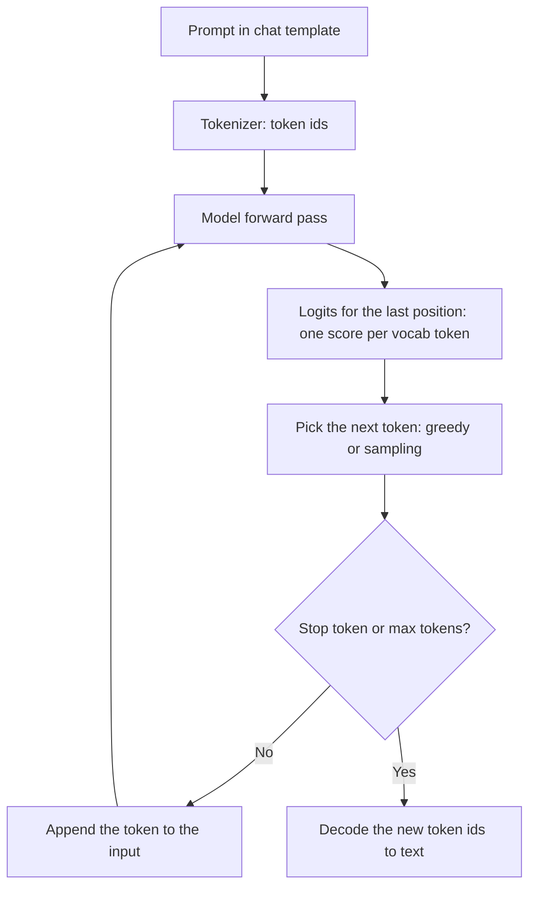
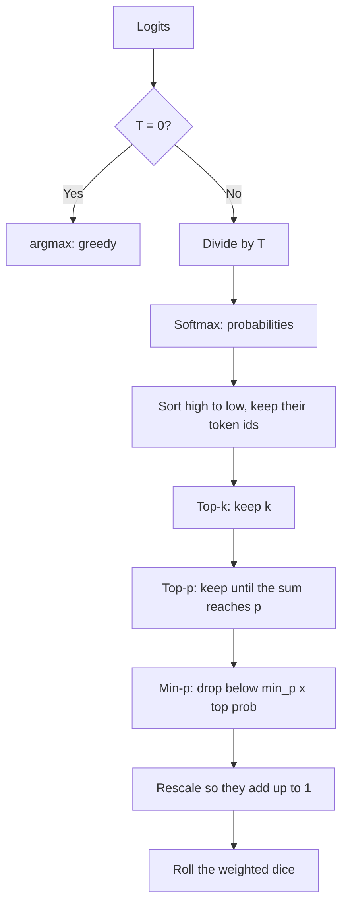
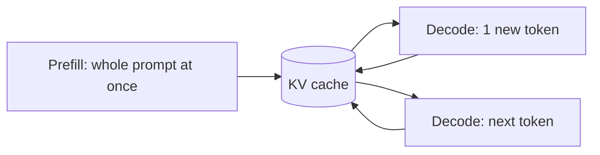

# Day 4: How LLMs Work 3 — Generation, Sampling & Hallucination 🎲

**Date:** 13 Nov 2026
**Notebooks (run on Google Colab):**
- [`notebooks/day04/decoding_strategies.ipynb`](../notebooks/day04/decoding_strategies.ipynb)
- [`notebooks/day04/kv_cache.ipynb`](../notebooks/day04/kv_cache.ipynb)

> **Goal:** Understand how a model turns scores into text, write my own sampling loop (greedy, temperature, top-k, top-p, min-p), measure the KV cache, and understand training stages and hallucination.

---

## 🎯 What I did today

- Studied the generation loop, decoding strategies, KV cache, prefill vs decode, training stages and hallucination
- Loaded **SmolLM2-360M-Instruct** on Colab and wrote my **own generation loop**; my greedy output matched the library's `generate()` exactly
- Implemented **temperature, top-k, top-p and min-p** myself, plus my own weighted dice instead of `torch.multinomial`
- Ran every setting several times on the same prompt and built a **setting → quality/variety → when to use** table
- Timed generation **with vs without the KV cache**, and **prefill vs decode** per token

---

## 1. The generation loop 🔁



- `model(token_ids)` = **one forward pass**. It returns logits of shape `(1, seq_len, vocab_size)`: a prediction for *every* position.
- Only the **last position** predicts the next token: `logits[0, -1, :]`.
- `model.generate()` hides this whole loop. I rebuilt it and got the identical answer.
- Inference does **not** train the model: weights stay frozen (`model.eval()`, `torch.no_grad()`). Learning needs a loss, backpropagation and weight updates.

### Chat template = the SFT format

```
<|im_start|>system
You are a helpful AI assistant named SmolLM, trained by Hugging Face<|im_end|>
<|im_start|>user
What is your name?<|im_end|>
<|im_start|>assistant
```

A 4-word question became **35 tokens** once the template and system message were added. Chat format costs tokens.

---

## 2. Decoding strategies 🎲

### Greedy: always the top token

```python
next_id = argmax(logits)
```

| Problem | Example |
|---------|---------|
| **Short-sighted**: best now ≠ best overall | `"The"` (0.5) then best next 0.3 → 0.15 total; `"A"` (0.4) then best next 0.9 → **0.36** total, but greedy picked "The" |
| **Repetition**: can get stuck in loops | `"I love AI. I love AI. I love AI..."` |

Best for: extraction, JSON, tool calls, where the same answer every time is a feature.

### Temperature

```
probs = softmax(logits / T)
```

**Worked example**, logits for 5 tokens:

| Token | Logit | T = 0.5 | T = 1 | T = 2 |
|-------|-------|---------|-------|-------|
| an | 1.0 | 0.016 | 0.083 | 0.148 |
| **SmolLM** | **3.0** | **0.860** | **0.612** | **0.403** |
| the | 0.5 | 0.006 | 0.050 | 0.115 |
| Smol | 2.0 | 0.116 | 0.225 | 0.244 |
| a | 0.0 | 0.002 | 0.030 | 0.090 |
| **Shape** | | Sharp | Normal | Flat |

- **T = 1** means no change. **T < 1** sharpens, **T > 1** flattens.
- **T = 0 is greedy.** Dividing by a smaller T makes the gaps bigger (`3/0.1 = 30`, `3/0.01 = 300`) while the **order never changes**, so the limit is "top token = 100%". The code returns `argmax` directly, because `logits / 0` would give `inf` and break softmax.
- **Why T = 0.7 is similar but not identical:** if the top token is picked 90% of the time, the chance all 30 tokens match greedy is `0.9³⁰ ≈ 4%`. One different pick snowballs into a different sentence.

### Sampling: the weighted dice 🎲

Lay the probabilities on a line from 0 to 1, draw one random number, and see where it lands:

```
probs = [0.59, 0.24, 0.17]

0 ──────────── 0.59 ────── 0.83 ──── 1.0
   token A          token B     token C

r = 0.70 → lands in token B
```

```python
def roll_dice(probs):
    r = random.random()
    running_total = 0.0
    for i in range(len(probs)):
        running_total += float(probs[i])
        if r < running_total:
            return i
    return len(probs) - 1  # safety net for rounding errors
```

This is what `torch.multinomial` does. The probabilities **must add up to 1**, so they are rescaled after filtering.

### Top-k, top-p and min-p

| Filter | Rule | Adapts to confidence? |
|--------|------|-----------------------|
| **Top-k** | Keep the k most likely tokens | ❌ Always k |
| **Top-p** | Keep the smallest set whose probabilities add up to p | ✅ |
| **Min-p** | Keep tokens with prob ≥ `min_p × top token's prob` | ✅ |

**Why top-p usually beats top-k:**

```
Confident: [Delhi 0.98, Mumbai 0.005, ...]
  top-k = 5   → keeps 4 junk tokens
  top-p = 0.9 → keeps only "Delhi"

Unsure: [good 0.12, pleasant 0.11, warm 0.10, cool 0.10, clear 0.09, lovely 0.09, ...]
  top-k = 5   → cuts off good options like "lovely"
  top-p = 0.9 → keeps every reasonable option
```

**Min-p example** (`min_p = 0.1`):

| Model state | Top prob | Threshold | Kept |
|-------------|----------|-----------|------|
| Confident | 0.90 | 0.09 | 1–2 tokens |
| Unsure | 0.15 | 0.015 | many tokens |

### The full pipeline (my implementation)



### Worked example of the pipeline

Sorted probabilities: `[0.50, 0.20, 0.15, 0.10, 0.05]`

```
Top-k = 3      → [0.50, 0.20, 0.15]
Top-p = 0.8    → 0.50 → 0.70 → 0.85 ≥ 0.8, keep 3 → [0.50, 0.20, 0.15]
Rescale (÷0.85)→ [0.59, 0.24, 0.18]
Dice           → 59% / 24% / 18% chance
```

`torch.sort` returns both the sorted probabilities **and** their original positions. The position in the logits array **is** the token id, so `sorted_ids[choice]` gives the real token.

### Not implemented, but important

- **Repetition penalty:** lower the scores of tokens that already appeared, so the model doesn't loop.
- **Stop sequences:** stop when a stop token (like `<|im_end|>`) appears; otherwise stop at `max_new_tokens` (the answer gets cut mid-sentence).

---

## 3. My sampling experiments 🧪

Prompt: *"Write one short sentence about the moon."*, each setting run 3 times.

| Setting | Different answers | What I saw |
|---------|------------------|------------|
| Greedy (T = 0) | 1 / 3 | Identical every time |
| Top-k = 1 (T = 1) | 1 / 3 | Identical, because k = 1 is greedy |
| T = 0.3 | 3 / 3 | Three versions of the same sentence |
| T = 0.7 | 3 / 3 | Fluent, but with false facts |
| T = 1.0, no filter | 3 / 3 | Odd phrasing creeping in |
| T = 1.5 / T = 2.0 | 3 / 3 | Nonsense |
| Top-k = 10 (T = 1) | 3 / 3 | Readable, some false facts |
| Top-p = 0.5 (T = 1) | 3 / 3 | Safe, similar answers |
| Top-p = 0.9 (T = 1) | 3 / 3 | Creative, readable |
| **T = 1.5 + Top-k = 10** | 3 / 3 | **Creative and still readable** |
| T = 1.5 + Top-p = 0.9 | 3 / 3 | Nonsense |
| T = 1.5 + Min-p = 0.1 | 3 / 3 | Nonsense |

**Findings:**

1. **Temperature controls everything.** Low T makes filters almost irrelevant; high T makes every method random.
2. **Fluent ≠ true.** Readable answers still had made-up facts, e.g. *"the largest natural satellite in the outer Solar System"*.
3. **Top-k tamed high temperature best:** it cuts by count, so flattening can't let more tokens in.
4. **Top-p and min-p failed at T = 1.5.** In my code temperature runs **before** min-p, so the top token is already tiny and `0.1 × top` lets thousands of tokens through. Real tools often apply min-p to the original probabilities and temperature **last**. **The order of samplers matters.**

### Setting → quality / variety → when to use

| Setting | Variety | Quality | Use for |
|---------|---------|---------|---------|
| Greedy (T = 0) / Top-k = 1 | None | Safe, identical | Extraction, JSON, classification, tool calls |
| T = 0.3 | Low | High | Factual answers, code |
| Top-p = 0.5 (T = 1) | Low–medium | High | Safe variety |
| T = 0.7 + Top-p = 0.9 | Medium | Fluent, small factual slips | General chat |
| T = 1.5 + Top-k = 10 | High | Still readable | Brainstorming, creative text |
| T ≥ 1.5 + Top-p / Min-p (after temperature) | Very high | Nonsense | Avoid |
| T ≥ 1.5, no filter | Very high | Nonsense | Avoid |

---

## 4. KV cache ⚡

**What it stores:** the **key and value vectors** of every past token, in every layer.
**What it doesn't store:** queries (each is used once) and MLP outputs.

**Why it is safe:** the causal mask means old tokens can never look at new ones, so their keys and values **never change**.

### Worked example: `"I love"` → 3 new tokens

| Step | Fed to the model | Cache after the step | New token |
|------|------------------|----------------------|-----------|
| Prefill | `[I, love]` | K, V for `I, love` | AI |
| Decode 1 | `[AI]` only | + `AI` | and |
| Decode 2 | `[and]` only | + `and` | coding |
| Decode 3 | `[coding]` only | + `coding` | . (stop) |

Without the cache, decode 3 would re-process `[I, love, AI, and, coding]`, the whole text, every step.



### My timing: with vs without the cache

| New tokens | With cache | Without cache | Speed-up |
|-----------:|-----------:|--------------:|---------:|
| 50 | 2.70 s | 2.47 s | 0.9x |
| 100 | 4.43 s | 5.51 s | 1.2x |
| 200 | 8.90 s | 16.62 s | 1.9x |

- For a **short** output the cache was slightly slower: re-processing a short text is cheap, and the cache has a small overhead.
- The benefit **grows with length**. Without the cache the work grows much faster than the length; with it, each step is one token. With real context lengths and big models, the cache is essential.
- **Trade-off:** the cache trades **memory** for speed (keys and values for every layer, head and token).

---

## 5. Prefill vs decode 🚌🚕

| | Prefill | Decode |
|---|---------|--------|
| What | The whole prompt at once | One new token per step |
| Parallel? | Yes | No: each token needs the previous one |
| Measures | **TTFT** (time to first token) | Time per output token |
| My result | Fast per token | **~50x slower per token** |

**Why output tokens cost more:** prefill fills the GPU with parallel work (a bus 🚌), while decode runs the whole model for a single token each step (a taxi per person 🚕), mostly waiting on memory.

**Agent lesson:** long context is relatively cheap; long answers are slow and expensive. Ask agents for **short, structured** output (like JSON).

---

## 6. Training stages 🏗️


Same question, *"What is the capital of India?"*:

| Stage | Typical answer |
|-------|----------------|
| Base model | *"What is the capital of Nepal? What is the capital of Bhutan?..."* (continues a quiz page) |
| After SFT | *"The capital of India is New Delhi."* |
| After preference tuning | *"The capital of India is New Delhi. It became the capital in 1931... Anything else?"* |

⚠️ Preference tuning rewards answers people like, which can create **sycophancy**: agreeing with a wrong premise to please the user.

---

## 7. Hallucination 🤥

**What:** confident, made-up output.

**Why it happens:**
1. Trained to predict the **next likely token**, not the **truth**.
2. **Knowledge gaps:** rare facts are stored weakly ("vague memory"); nothing after the cutoff.
3. SFT data rarely says **"I don't know"**, so the model learns to always answer.
4. Preference tuning → **sycophancy**: accepting wrong premises.
5. **Snowballing:** one wrong token, and the model keeps justifying it.
6. **No way to check** facts without tools.

**Seen in my own runs:**
- SmolLM refused *"What is the capital of India?"*, claiming it can't give geographical information (false, and an over-refusal).
- It said its name correctly (from the **system prompt**, in context) but invented a purpose (*"language learning"*, from weights).
- Fluent sampled answers contained false facts about the moon.

> **Context beats memory:** facts in the prompt are reliable; facts from weights are vague recollections.

**How to reduce it:**
- Put facts in the **context** (RAG, tool results). Prices and stock always come from a tool, never from the model's memory.
- Allow and ask for **"I don't know"**, or `null` for missing fields.
- **Validate** outputs: schema checks, business rules, and grounding (is this value really in the source?).
- Low temperature makes answers **consistent**, not **correct**.

### Temperature 0 is not fully deterministic

GPUs add numbers in different orders (batching with other requests), and floating-point rounding means `(a + b) + c` can differ slightly from `a + (b + c)`. When two tokens are almost tied, that tiny difference can flip the pick, and the rest snowballs.

**Design for variance:** validate every output, retry on failure, get facts from tools, write tests that check key content instead of exact text, and log responses.

### Example: invoice extraction agent

| Part | Choice |
|------|--------|
| Sampling | `temperature = 0` |
| Format | JSON schema, validated (e.g. with Pydantic); retry if invalid |
| Rules | Date not in the future, total > 0, line items add up to the total |
| Grounding | Every extracted value must appear in the invoice text |
| Missing fields | Return `null`, never guess |

---

## 8. Python and PyTorch I used 🐍

| Code | Meaning |
|------|---------|
| Tensor | A multi-dimensional array (like NumPy) that runs on the GPU |
| `model(token_ids)` | One forward pass → logits |
| `model.generate(...)` | The library's full generation loop |
| `outputs.logits[0, -1, :]` | Scores for the next token (last position) |
| `torch.argmax(x)` | Index of the biggest value |
| `torch.softmax(x, dim=-1)` | Scores → probabilities |
| `torch.sort(x, descending=True)` | Sorted values **and** their original positions |
| `torch.multinomial(probs, 1)` | Weighted random pick |
| `torch.cat([a, b], dim=1)` | Append a token to the sequence |
| `model.eval()`, `torch.no_grad()` | Inference only, no training |
| `past_key_values` | The KV cache |
| `time.perf_counter()` | Precise timing |
| `torch.cuda.synchronize()` | Wait for GPU work before reading the clock |
| `set(answers)` | Unique items only |
| `s.get("min_p")` | Read a dict key, `None` if missing |

**Python rule:** keyword arguments must come **after** positional ones: `f(a, b=2, c)` is a `SyntaxError`.

---

## 🐛 Problems I faced (and how I fixed them)

| Problem | Fix |
|---------|-----|
| Torch may not support Python 3.15 yet | Ran Day 4 on Google Colab |
| SmolLM refused a simple question | Small model + over-refusal; changed the prompt and used it as a hallucination example |
| `pick_next_token(logits, temperature=2, top_k, top_p)` | `SyntaxError`, and a hard-coded value ignores the caller's setting; pass the parameters through |
| `NameError: torch is not defined` | Colab reset the runtime after idle time; re-ran the setup cell |
| Timing cell was very slow | Expected: without the cache, every token re-processes the whole text |
| Cache slower at 50 tokens | Short texts are cheap to recompute; the cache has overhead |
| Min-p gave nonsense at T = 1.5 | Temperature was applied before min-p; sampler order matters |

---

## 💡 3 Takeaways

1. **Temperature decides how random the model is; filters decide which tokens may be picked, and their order matters.** Top-k = 10 kept T = 1.5 readable; top-p and min-p (after temperature) did not.
2. **Output tokens are the expensive part.** Decode was ~50x slower per token than prefill, and the KV cache's advantage grows with length.
3. **Fluent is not true.** Models produce confident mistakes, and T = 0 isn't perfectly deterministic, so agents need facts from context or tools **and** validation.

---

## 🎤 Interview-ready answers

- **Greedy vs sampling?** Greedy always takes the top token (deterministic, can be short-sighted or repetitive); sampling draws from the probabilities (variety).
- **Top-k vs top-p?** Top-k keeps a fixed count; top-p keeps the smallest set reaching p, so it adapts to the model's confidence.
- **What does temperature do?** Divides logits before softmax: low T sharpens, high T flattens, T = 1 changes nothing, T = 0 is greedy.
- **What is the KV cache?** Saved keys and values of past tokens, so each new token needs only one step; it trades memory for speed.
- **Prefill vs decode?** Prefill processes the prompt in parallel (TTFT); decode makes one token at a time, so output tokens are slower and pricier.
- **Training stages?** Pretraining (base model) → SFT (assistant) → preference tuning (helpful, safe) → RL for reasoning.
- **Why do models hallucinate?** Trained for likely text, not truth; weak memory of rare facts; trained to always answer; sycophancy; no way to check.
- **Settings for a JSON extraction agent?** T = 0, schema validation, business-rule checks, grounding, `null` for missing fields, retries.

---

## ⏭️ Next

- Day 5 of the roadmap
- 🅿️ Parking: test min-p applied **before** temperature