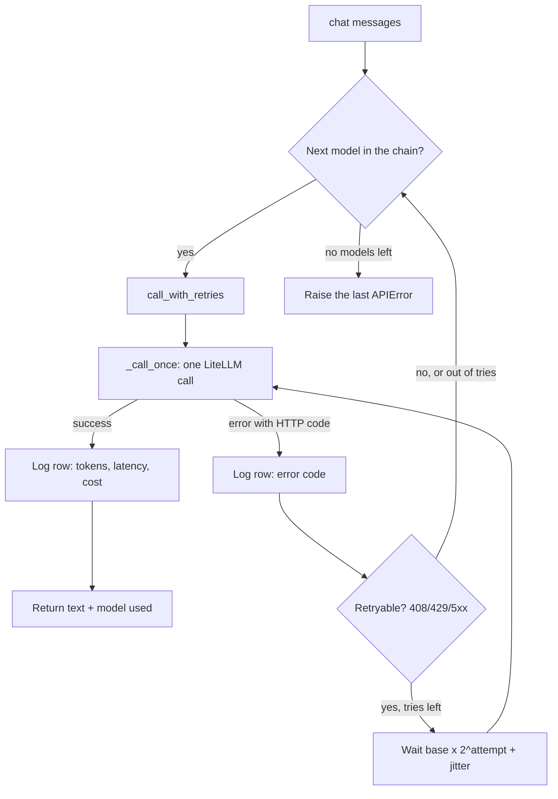

# Day 5: LLM APIs like a pro

**Date:** 14-15 Nov 2026
**Goal:** Learn how real LLM apps talk to APIs (messages, streaming, failures, retries, cost, fallback), then build one reusable client that every later project can use.

**Built today**

| File | What it is |
|---|---|
| `src/agentic_ai_120/retry.py` | `APIError` + `call_with_retries()` (exponential backoff + jitter) |
| `src/agentic_ai_120/llm_client.py` | `chat(messages, model=None, stream=False)` over LiteLLM: retries, timeout, fallback chain, SQLite call log |
| `tests/test_retry.py` | 10 tests for the retry logic (fake API, fake sleep) |
| `tests/test_llm_client.py` | 6 tests for `chat()` (fake LiteLLM, temporary database) |
| `notebooks/day05/list_models.py` | Asks each provider which models exist right now |
| `notebooks/day05/llm_client_explore.ipynb` | Step-by-step experiments that became `llm_client.py` |

---

## 1. The big picture



Three layers, one job each:

```
chat()                  -> which model?        (fallback chain)
  call_with_retries()   -> how many tries?     (retry + backoff)
    _call_once()        -> one real call       (log it, turn LiteLLM errors into APIError)
```

Why layers: each layer can be tested on its own (the retry logic is tested without any API), and `retry.py` can be reused for any API, not only LLMs. A single function with two loops (`for model` / `for attempt`) does the same job and is easier to read top to bottom, but it can't be tested or reused in parts.

---

## 2. Messages format

Every call sends a **list of messages**, each one `{"role": ..., "content": ...}`.

| Role | Written by | Job |
|---|---|---|
| `system` | Developer | Rules and behaviour. Has more weight than user messages (instruction hierarchy) |
| `user` | The person | The question or request |
| `assistant` | The model (earlier turns) | Conversation history |
| `tool` | **Our code** | The result of a tool the model asked us to run |

Example: `system: "Answer in one word only."` + `user: "What is the capital of India?"` -> `"Delhi"`. Even if the user then says "explain in detail", a well-behaved model keeps the system rule. Users trying to override the system rules = **prompt injection**.

**Tool flow (preview of agents):**

```
user: "Paracetamol kitne ki hai?"
assistant: asks for get_price(medicine="Paracetamol")   <- model only ASKS, as JSON
our code: runs the function -> {"price": 18}            <- validate arguments before running!
tool: {"price": 18}
assistant: "Paracetamol 500mg strip costs Rs 18."
```

The model never runs functions itself.

Inside the API, the messages list is turned into the model's chat template (`<|im_start|>system ... <|im_end|>`, seen on Day 4).

**Provider differences:** OpenAI/Groq/OpenRouter use `assistant` and a `system` message. Gemini uses `model` and a separate `system_instruction`. LiteLLM hides this.

---

## 3. APIs are stateless

The API remembers nothing between calls. The **app** (not the model) sends the whole history every time.

```
Call 2 without history: [user: "Mera naam kya hai?"]                    -> "I don't know"
Call 2 with history:    [user: "Mera naam Mayank hai",
                         assistant: "Hello Mayank!",
                         user: "Mera naam kya hai?"]                    -> "Mayank"
```

**Effects:**

1. Cost grows every turn. With 50 user + 100 assistant tokens per turn, input tokens sent per call are 50, 200, 350, ... 1,400 at turn 10. Total input over 10 turns: 10 x 50 + 150 x (0+1+...+9) = **7,250 tokens** for only 1,500 tokens of new content.
2. The context window fills up, so old messages get cut and the model "forgets".
3. We control memory: summarize old turns, pin key facts in the system message, drop noise.
4. Risk: whoever sends the history can fake it (a fake `assistant` message). Keep history on the server.

---

## 4. Streaming and SSE

Without streaming the server builds all tokens, then sends one JSON. With streaming it sends each piece as soon as it is decoded. **The model generates token by token either way**; only the delivery changes.

| | Non-streaming HTTP | SSE streaming |
|---|---|---|
| Connection | Closes after one answer | Stays open, server keeps sending |
| First text seen | After the whole answer | After TTFT |
| Total time | Same | Same |

**Worked example:** TTFT 0.5 s, 100 tokens x 50 ms = 5 s, total 5.5 s. Without streaming the user sees a blank screen for 5.5 s. With streaming they start reading at 0.5 s. Streaming doesn't make the work faster; it makes the wait feel shorter.

**What the server actually sends (SSE):**

```
data: {"choices":[{"delta":{"content":"The"}}]}

data: {"choices":[{"delta":{"content":" capital"}}]}

data: [DONE]
```

| Part | Meaning |
|---|---|
| `data:` | SSE label: "here is one chunk" (not part of the JSON) |
| `choices[0]` | First answer (same idea as Gemini's `candidates[0]`) |
| `delta` | Only the **new** piece since the last chunk (non-streaming uses `message` with the full text) |
| `content` | The text piece |
| `[DONE]` | No more chunks, connection closes |
| `finish_reason` | `null` while running, `"stop"` or `"length"` on the last chunk |

**How to switch it on:** Gemini SDK uses a different function (`generate_content_stream`). OpenAI/Groq/LiteLLM use a flag (`stream=True`).

**Why a `for` loop can wait for future chunks:** the stream is a **generator**, not a list. The loop calls `next()`; `next()` blocks until the next chunk arrives; the generator hands it over with `yield` and pauses. When the server sends `[DONE]`, the generator raises `StopIteration` and the loop ends. Only then does the code move below the loop.

```python
for chunk in stream:  # same as: while True: chunk = next(stream) ...
    print(chunk.text, end="", flush=True)
```

**When not to stream:** an invoice -> JSON agent. JSON is only useful when complete, a broken connection leaves useless half-JSON, and nobody is watching, so streaming adds complexity for no benefit.

---

## 5. Failures: status codes, rate limits, timeouts

| Code | Meaning | Whose fault | Retry? |
|---|---|---|---|
| 400 | Bad request (bad parameter, prompt too long) | Ours | No, fix it |
| 401 | Missing or wrong API key | Ours | No, fix the key |
| 403 | Key valid but not allowed | Ours | No |
| 404 | Wrong model name | Ours | No |
| 408 | Request timeout | Network | Yes |
| 429 | Too many requests (rate limit) | Ours (too fast) | Yes, after waiting |
| 500 / 503 / 504 | Server error / busy / gateway timeout | Server | Yes, with backoff |

Rule: **4xx = our mistake, don't retry (except 408 and 429). 5xx = server problem, wait and retry.**

**Rate limits:** RPM (requests per minute), TPM (tokens per minute), RPD (requests per day). Whichever runs out first gives the 429.

*Worked example:* RPM 15, TPM 100,000, 10,000 tokens per call -> TPM allows 100,000 / 10,000 = **10 calls**, RPM allows 15, so TPM is hit first: **10 calls per minute**.

If RPD is used up, retrying is pointless until tomorrow, so **fall back** to another provider. Respect a `Retry-After` header when the server sends one.

**Timeouts:** without one, a stuck server freezes the app forever. Too short cuts long answers (decode is slow), too long leaves users waiting. Danger: a timeout means "no answer came back", not "nothing happened". The work may have been done, so a retry can do it twice (see idempotency).

**Timeouts multiply with retries:** 4 tries x 30 s timeout + backoff is more than 2 minutes on one model before the fallback even starts. Pick both numbers together.

---

## 6. Exponential backoff + jitter

```
wait = base x 2^attempt + random(0, 1)       (multiply, not add)
```

| Attempt | base = 1 s | base = 2 s |
|---|---|---|
| 0 | 1 s | 2 s |
| 1 | 2 s | 4 s |
| 2 | 4 s | 8 s |
| 3 | 8 s | 16 s |

*Worked example:* base = 2, four retries, no jitter: 2 + 4 + 8 + 16 = **30 s**.

- **Why doubling:** short glitches recover fast; long outages are not hammered with useless calls.
- **Why jitter:** without it, 1000 clients that failed together all retry at the same moment and knock the server down again (thundering herd). Jitter spreads them out.
- **Limits:** a max number of retries (then fall back) and a max wait.

---

## 7. Idempotency and cost

**Idempotent** = doing it once or ten times gives the same result.

| Action | Idempotent? |
|---|---|
| Update a user's address | Yes, it ends up the same |
| Add Rs 100 to a wallet | **No**: a retry after a lost reply turns 1,100 into 1,200 |
| Ask an LLM for a summary | Yes in effect: nothing in the world changes (the text may differ because of sampling), only tokens are spent |
| Send an email / charge a card / create an order | **No** |

**Fix: idempotency key.** Give each action a unique ID. The tool remembers which IDs are done; if the same ID comes again, it returns the old result instead of acting again (like a PNR: the same PNR can't book two seats).

**Cost per call:**

```
cost = input_tokens x input_price / 1,000,000 + output_tokens x output_price / 1,000,000
```

*Worked example:* input $0.20/1M, output $0.80/1M, 5,000 input + 1,000 output tokens:
5,000 x 0.20 / 1M = $0.0010, 1,000 x 0.80 / 1M = $0.0008, **$0.0018 per call**, **$1.80 per 1,000 calls**.

Hidden costs: thinking tokens (usually billed as output), every retry is a new paid call, the system prompt is sent on every call, Hindi/Hinglish needs more tokens (Day 2).

---

## 8. LiteLLM and the fallback chain

LiteLLM = one function and one format for 100+ providers. Only the model string changes:

```python
completion(model="groq/openai/gpt-oss-20b", messages=messages, timeout=30)
completion(model="gemini/gemini-3.8-flash", messages=messages, timeout=30)
```

It translates roles and response shapes, reads keys from `.env` (`GEMINI_API_KEY`, `GROQ_API_KEY`, `OPENROUTER_API_KEY`), gives the same error types for every provider (each with a `status_code`), supports `stream=True`, and can estimate cost.

**Model names come from the providers, not from memory** (`list_models.py`). Skip non-chat models: `whisper` (speech to text), `orpheus` (text to speech), `prompt-guard` / `safeguard` (safety classifiers), `native-audio`. Being in the list doesn't guarantee access: `gemini-2.5-flash` is listed but gave 404 on Day 1.

**Fallback rules:** after retries fail on 5xx/timeout, or immediately on an RPD 429, move to the next model. On 401, falling back is fine but send an alert (the key is broken). On 400, stop: every model will fail.

**Log which model answered:** to debug odd answers, compare cost, and spot failing providers. After some days of logs, reorder the chain using the data.

---

## 9. My results

**First real LiteLLM calls** (`"In one sentence, what is an AI agent?"`):

| Model | Run 1 | Run 2 |
|---|---|---|
| `gemini/gemini-3.8-flash` | 503 "high demand" | Timeout (408) after 30 s |
| `groq/openai/gpt-oss-20b` | OK, 0.60 s, 81 in / 89 out tokens | OK, 0.71 s, 81 in / 132 out tokens |
| `openrouter/google/gemma-4-31b-it:free` | 401 (wrong key in `.env`) | 429 "rate-limited upstream" |

Every failure type from the theory showed up live in one night: 503, timeout (408), 401 and 429. Groq answered every time, so the chain order was changed to **Groq -> Gemini -> OpenRouter**.

**Tests:** `test_retry.py` 10 passed, `test_llm_client.py` 6 passed, all in under a second with no internet.

---

## 10. Python and testing concepts learned today

**Custom exception:** `class APIError(Exception)`. Inheriting from `Exception` is required: Python refuses to `raise` or `except` anything else (`TypeError: exceptions must derive from BaseException`). It also gives the message, traceback and `pytest.raises` support for free.

**`try / except`:** when an error is raised, the rest of the `try` block is skipped and Python looks for a matching `except`. `except APIError as error` catches only `APIError` and names the object `error`, so `error.code` can be read. Other error types fly on up (bugs should not be hidden by retries). A bare `raise` inside `except` re-throws the same error.

**`raise NewError(...) from error`:** links the original error as `new_error.__cause__`. The traceback then says "The above exception was the direct cause of...". Without `from` it says "During handling of the above exception, another exception occurred", which looks like a bug.

**Default parameters:** `def __init__(self, code, message="")` -> `APIError(503)` is valid; `message` becomes `""`.

**Functions are values:** `call_with_retries(fake_api)` passes the function without brackets so the retry code can run it as many times as it needs. `fake_api()` with brackets would pass a single result.

**Generator vs closure:**

| | Generator (`yield`) | Closure |
|---|---|---|
| Remembers | Where the function paused | Variables of the outer function |
| Next call | Continues from the pause | Starts from the top |

A closure holds a **link** to the outer variables, not a copy. That's why the test can read `calls["count"]` that the fake API keeps changing. Every call to `make_fake_api()` creates a new function with its own fresh variables.

**pytest:**

| Tool | Use |
|---|---|
| `tests/test_*.py`, `def test_*()` | How pytest finds tests |
| `assert` | The check |
| Arrange / Act / Assert | The shape of every test |
| `pytest.raises(APIError) as error_info` | The error must happen; check `error_info.value.code` too, otherwise any `APIError` passes |
| `monkeypatch.setattr(module, "name", fake)` | Temporarily swap something for a fake; undone after the test |
| Patch where it is **used** | `llm_client` does `from litellm import completion`, so patch `llm_client.completion` |
| `@pytest.fixture` | Reusable setup; a test asks for it by writing its name as a parameter; fresh for every test |
| Built-in fixtures | `monkeypatch`, `tmp_path` (a temporary folder per test) |
| `@pytest.mark.parametrize` | One test, many inputs, each reported separately |
| `types.SimpleNamespace` | Quick fake object shaped like a real response |

Fixture vs monkeypatch: monkeypatch does the swapping; a fixture is the reusable box that holds any setup (a patch, sample data, a temporary database).

**SQLite + SQL injection:** a whole database in one file (`sqlite3` is built in). Always use `?` placeholders. Gluing user text into SQL with an f-string lets input like `' OR '1'='1` turn into a command that returns every row (and a name like `D'Souza` breaks the query). With `?`, the command is fixed and the input is only data.

Summary query used on the call log:

```sql
SELECT model, COUNT(*), SUM(success),
       AVG(CASE WHEN success = 1 THEN latency_ms END),
       SUM(COALESCE(cost_usd, 0))
FROM calls GROUP BY model;
```

---

## 11. Interview answers

**Q: Your LLM app sometimes gets 429 and 503 errors. What do you do?**
Retry only retryable codes (408, 429, 5xx) with exponential backoff plus jitter and a retry cap, respect `Retry-After`, never retry 4xx like 401/404, and fall back to another provider when retries run out or the daily quota is gone. Log every call to see which provider is failing.

**Q: Why does streaming feel faster if the total time is the same?**
The user sees the first tokens after TTFT instead of after the full generation, and reads while the rest arrives. It's a UX win, not a speed win. For structured output like JSON that must be validated, streaming adds little.

**Q: What is idempotency and why does it matter for agents?**
An operation that gives the same result no matter how many times it runs. Retries after timeouts can repeat side effects (double payments, duplicate emails), so side-effect tools need idempotency keys.

**Q: How do you test code that calls an LLM API?**
Replace the API with a fake (monkeypatch, patched where it is used) that follows a script: return text, raise a 503, raise a 401. Also patch `time.sleep`. Tests are fast, free, deterministic, and can produce errors on demand.

**Q: How would you estimate the monthly LLM cost for a client?**
(input tokens x input price + output tokens x output price) per call, times calls per month. Remember history growth, system prompt on every call, retries, thinking tokens and language (Hindi uses more tokens).

---

## 12. Problems I faced

| Problem | Cause | Fix |
|---|---|---|
| `mkdir tests(Set-ExecutionPolicy ...)` error | VS Code's venv activation got glued to my command | Wait for the terminal to finish, run the command alone |
| OpenRouter 401 "Missing Authentication header" | My Groq key (`gsk_...`) was in the `OPENROUTER_API_KEY` line | New OpenRouter key; checked only the first characters, never printed the key |
| New key not picked up in the notebook | The kernel kept the old value; `load_dotenv()` doesn't overwrite by default | Restart kernel or `load_dotenv(override=True)` |
| Traceback printed in the middle of the next model's output | stderr and stdout are shown separately | `traceback.print_exception(error, file=sys.stdout)` |
| `pytest.raises(APIError)` passed for any code | It only checks the type | `as error_info` + `assert error_info.value.code == 401` |
| Ruff RUF059: unpacked `calls` never used | Test didn't assert it | Added `assert calls["count"] == 4` (stronger test) |
| Ruff format "files were modified" | Formatter changed files during commit | `git add .` and commit again |
| `NameError: chat_layered` | I kept the earlier `chat_with_fallback` cell | Called `call_model_once` directly for the logging test |

---

## 13. Takeaways

1. Real LLM apps fail more from rate limits, timeouts and cost than from prompts. Plan for failure.
2. Retry only what retry can fix. Bugs and bad keys must stay visible.
3. Timeouts and retries multiply; choose them together.
4. Side effects + retries = danger without idempotency keys.
5. Never guess model names; ask the provider, then test with a real call.
6. Log every call; let data decide the fallback order.
7. Tests with fakes make retry and fallback logic provable in milliseconds.

## 14. Next steps

- Week 1 revision: README roadmap, Feynman, self-test, weekly review.
- POST #2: tokens carousel (Hinglish ~1.8x, Hindi up to 5.4x on GPT-4).
- From now on, "I write first": rewrite `retry.py` from an empty file using the existing tests, and finish the Day 2 `encode_b` challenge.
- Parking lot: `async` for many users at once, decorators, LiteLLM's built-in `num_retries` / `fallbacks`, streaming errors mid-stream.