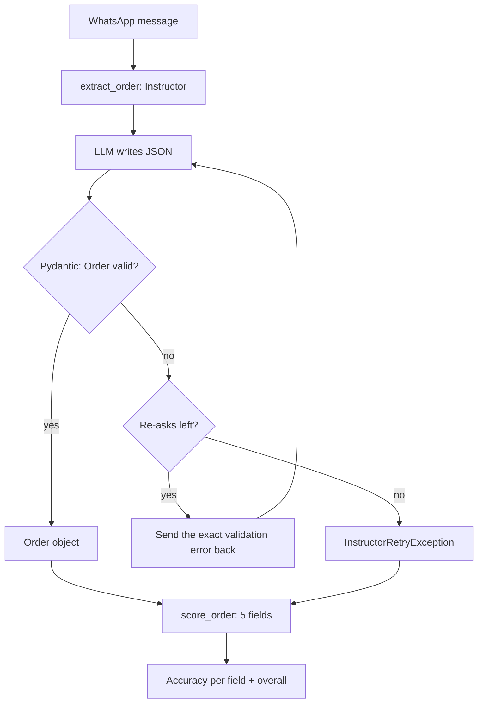

# Day 8: Structured outputs: from text to reliable JSON

**Date:** 19 Nov 2026 (theory earlier; code done after Day 9)
**Goal:** Turn messy WhatsApp orders (English, Hinglish, typos) into reliable data with Pydantic + Instructor, and measure it field by field. Target: 90%+ field-level accuracy on 30 messages.

**Built today**

| File | What it is |
|---|---|
| `src/agentic_ai_120/order_models.py` | Pydantic `Order` / `OrderItem`: types, a fixed list of modifiers, a menu validator, a "no modifiers in unavailable_items" validator |
| `src/agentic_ai_120/extractor.py` | `extract_order(message)` with Instructor + LiteLLM: JSON mode, re-ask loop (max 2), counts re-asks |
| `src/agentic_ai_120/order_scoring.py` | Field-level scoring: 5 separate 0/1 scores per message |
| `tests/test_order_models.py` | 16 tests |
| `tests/test_order_scoring.py` | 8 tests (81 tests in the repo now) |
| `evals/order_extraction/messages.csv` | 30 WhatsApp-style messages with expected items, modifiers, unavailable items, time and notes |
| `evals/order_extraction/run_extraction_eval.py` | Runs all 30, saves `results.csv`, prints accuracy per field and overall |
| `evals/order_extraction/results_run1.csv` | The first run, kept as the "before" |

New dependencies: `pydantic`, `instructor`.

---

## 1. The big picture



---

## 2. Why structured outputs

Apps need **data** (an order, a booking), not prose. "2 butter chicken aur 4 naan" must become something code can use:

```json
{"items": [{"name": "butter chicken", "qty": 2, "modifiers": []},
           {"name": "naan", "qty": 4, "modifiers": []}],
 "unavailable_items": [], "delivery_time": null, "notes": null}
```

Regex on free text breaks in week one: typos, Hinglish, "nahi nahi", numbers as words.

---

## 3. Three levels of getting JSON

| Level | How | Guarantees | Does NOT guarantee |
|---|---|---|---|
| Prompt only | "Output only JSON" (my Day 7 v2) | Nothing | Valid JSON (v1 wrapped it in code fences) |
| JSON mode | `response_format={"type": "json_object"}` | Valid JSON syntax | Your fields, your types |
| Schema-constrained decoding | `response_format` with a JSON Schema (strict) | Your exact shape | That the values are **right** |

**How constrained decoding works:** at every step, tokens that would break the schema get their logits set to −∞, so their probability becomes 0 (Day 4: logits → softmax → sampling). It's the same −∞ trick as the causal mask (Day 3). After `{"qty": ` only digits are allowed.

**No level guarantees business rules or correctness.** "pizza" is a valid string. `qty: 1` is a valid number even when the customer said 4 (see my run 1).

---

## 4. Pydantic

```python
Modifier = Literal[
    "extra spicy",
    "less spicy",
    "no onion",
    "no garlic",
    "extra butter",
    "less oil",
    "no ice",
]


class OrderItem(BaseModel):
    name: str = Field(description="Exact menu name, ...")
    qty: int = Field(
        ge=1,
        description="How many. Always write it: 1 if the customer didn't say a number.",
    )
    modifiers: list[Modifier] = Field(
        description="Changes asked for on THIS dish. [] if none."
    )

    @field_validator("name")
    @classmethod
    def must_be_on_menu(cls, value):
        name = value.strip().lower()
        if name not in MENU_NAMES:
            raise ValueError(
                f"'{value}' is not on the menu. ... or put it in unavailable_items ..."
            )
        return name
```

| Tool | Use in my code |
|---|---|
| Types (`int`, `str`, `list[...]`) | `qty` must be a number; `"2"` is converted to 2, `"two"` fails |
| `Literal[...]` | Only 7 modifiers allowed; "bina pyaaz" must become "no onion" |
| `str | None` | `delivery_time` and `notes` can be empty (`null`) |
| `Field(ge=1)`, `Field(pattern=...)` | qty at least 1; time must look like `20:30` |
| `@field_validator` | Business rules: the menu, and no modifiers in `unavailable_items` |
| `ValidationError` | Says which field failed and why, e.g. `items.0.qty: Field required` |

`Field(description=...)` goes into the JSON Schema, so the description is also an instruction for the model (like tool descriptions on Day 9).

---

## 5. Schema-valid vs business-valid vs right

| Example | Schema-valid? | Business-valid? | Right? |
|---|---|---|---|
| `{"name": "pizza", "qty": 2}` | Yes | **No**: not on the menu | No |
| `unavailable_items: ["less oil"]` | Yes | **No**: a modifier is not a dish | No |
| `{"name": "naan", "qty": 1}` for "4 naan" | Yes | Yes | **No** |

The first two are caught by my validators and fixed by the re-ask. The third can only be caught by an **eval**: that's why the test set and field scores exist.

---

## 6. Instructor and the re-ask loop

1. Instructor turns `Order` into a JSON Schema and sends it with the messages.
2. It reads the reply into an `Order`.
3. If Pydantic fails, it adds the model's reply and the **exact error** to the messages and asks again.
4. `max_retries=2`: at most 2 re-asks (3 calls). After that, `InstructorRetryException`.

What the model gets back on a re-ask (seen in my test):
```
Correct your JSON ONLY RESPONSE, based on the following errors:
1 validation error for Order
unavailable_items
  Value error, 'less oil' is a modifier, not a dish. Put it in the modifiers of the dish it belongs to.
```

**Why `max_retries` matters:** every re-ask is one more paid call with the whole history (Day 5 cost). A model that can't fix something will not fix it on the 10th try either.

| | Day 5 retry | Day 8 re-ask |
|---|---|---|
| Fixes | Network/server errors (429, 503) | Content errors (wrong field, off-menu item) |
| Sends | The same request again, after a wait | The request + the model's answer + the error |
| Who decides | HTTP status code | Pydantic |

**Modes** (how Instructor asks for JSON): `TOOLS` (the schema as a tool), `JSON` (JSON mode + the schema in the prompt), `JSON_SCHEMA` (constrained decoding). In run 1, `TOOLS` mode on Groq gave 400 errors before Pydantic ever saw the reply, so the re-ask had nothing helpful to send. `JSON` mode keeps every check in **my** Pydantic.

---

## 7. Partial / streamed objects (theory only)

Instructor can stream a `Partial[Order]`: fields fill in as tokens arrive (items first, then time, then notes). Useful when a UI should show the order being filled in. The object is only fully validated at the end, so don't act on a partial one.

## 8. Temperature

Extraction has one right answer, so `temperature=0` (Day 4): the most likely token every time, stable results between runs.

---

## 9. Field-level accuracy

Each message gets **5 separate scores** instead of one "whole order right or wrong":

| Field | Right when |
|---|---|
| `items` | The set of (name, qty) equals the expected set (order doesn't matter) |
| `modifiers` | The set of (dish, modifier) equals the expected set |
| `unavailable` | Every expected word is found (e.g. "pizza" in "Pizza (2)"); empty when none expected |
| `delivery_time` | Exactly equal (`20:00`), or both empty |
| `notes` | The key word is in the note ("guard" in "Give it to the guard"); empty when none expected |

**Why it's better:** "whole order right" says *that* something failed. Field scores say *what* failed. In run 1, notes and time were perfect on every message that ran, and **items** was the problem. That pointed straight at the bug.

Field-level accuracy = right fields / (messages × 5).

---

## 10. My rules for the expected answers

| Case | Rule |
|---|---|
| No quantity | qty 1 |
| Hindi numbers | ek 1, do 2, teen 3, char 4, paanch 5 |
| Mind change ("nahi nahi", "actually") | Final choice only |
| Modifier words | Map to the 7 allowed: "bina pyaaz" no onion, "kam teekha" less spicy, "extra teekha" extra spicy, "bina barf" no ice |
| Not on the menu | `unavailable_items`, never `items` |
| Clock time | 24-hour `HH:MM`: "raat 8 baje" 20:00, "dopahar 1 baje" 13:00, "sham 6 baje" 18:00 |
| "jaldi", "abhi", "asap" | No time, and not a note |
| Notes | Rider/kitchen instructions only: gate, guard, floor, flat number, packing, cutlery, doorbell |

---

## 11. My results

### Run 1: 58% (87/150)

TOOLS mode, `qty` had `default=1`, 4-second pause.

| Field | Right | |
|---|---|---|
| items | 6/30 | 20% |
| modifiers | 17/30 | 57% |
| unavailable | 20/30 | 67% |
| delivery_time | 22/30 | 73% |
| notes | 22/30 | 73% |

**Error analysis:**

| Finding | Evidence | Cause | Fix |
|---|---|---|---|
| Every qty came back as 1 | "2 butter chicken aur 4 naan" gave qty 1 and 1. The 6 "right" rows were exactly the rows where every expected qty was 1 | `qty` had `default=1`, so it was optional in the schema. The model skipped it and Pydantic filled in 1, **silently** | No default: `qty` and `modifiers` are required, so a missing value is an error and gets a re-ask |
| Modifiers in the wrong field | Row 24: `unavailable_items: ["less oil", "no onion", "no garlic"]`; row 29: `["extra butter"]`; rows 3, 8, 10 lost their modifier | Weak field descriptions, no business check | Validator: a modifier in `unavailable_items` raises an error; clearer descriptions and prompt rules |
| 6 messages failed with 400 | `BadRequestError: GroqException` | TOOLS mode: Groq rejected the reply itself, before Pydantic | `instructor.Mode.JSON` |
| 2 messages failed with 429 | `RateLimitError` | Groq tokens-per-minute limit | 8-second pause + `num_retries=3` in LiteLLM |

**Hidden good news:** on the 22 messages that ran, `delivery_time` 22/22, `notes` 22/22, every dish name was right, and every off-menu item (pizza, raita, gulab jamun, pasta, garlic bread) went to `unavailable_items`. Row 12 ("5 plates of chiken biryani nhi nhi veg biyani") came out as `veg biryani`: the self-correction that failed in every Day 7 prompt.

Delivery time and notes being exactly 22/30 was the clue that 8 messages had failed completely (a failed message scores 0 on all 5 fields).

### Run 2: after the fixes

(fill in from my run)

| Field | Right |
|---|---|
| items | _/30 |
| modifiers | _/30 |
| unavailable | _/30 |
| delivery_time | _/30 |
| notes | _/30 |
| **Field-level accuracy** | **_%** (target 90%) |
| Whole order fully right | _/30 |
| Re-asks / failed | _ / _ |

---

## 12. Python concepts used

| Concept | Where |
|---|---|
| `Literal[...]` + `get_args()` | The modifier list as a type, and as a plain list for the validator |
| `@field_validator` + `@classmethod` | Business rules inside the model |
| `Field(default_factory=list)` | A fresh empty list for every order (never `default=[]`, which would be shared) |
| No default = required | The fix for the silent `qty: 1` |
| Instructor hooks: `client.on("parse:error", ...)` | Counting re-asks |
| Set comprehensions | `{(item.name, item.qty) for item in order.items}` for order-free comparison |
| `model_dump_json()` | Saving the extracted order in `results.csv` |
| `Copy-Item` (PowerShell) | Keeping run 1's results before run 2 overwrites them |

---

## 13. Interview answers

**Q: JSON mode vs structured outputs?**
JSON mode guarantees valid JSON syntax but not your fields or types. Structured outputs (schema-constrained decoding) guarantee your exact schema by masking invalid tokens at each step. Neither guarantees the values are correct or follow business rules, so you still validate and evaluate.

**Q: How does constrained decoding work?**
At every step the decoder knows which tokens can continue a valid JSON for the schema. It sets the logits of every other token to −∞, so after softmax their probability is 0 and they can never be sampled.

**Q: The customer orders "2 pizza", which isn't on the menu. What happens?**
The JSON is schema-valid, but my validator rejects it: "'pizza' is not on the menu ... put it in unavailable_items". Instructor re-asks with that error, and the model moves pizza to `unavailable_items`. The app can then tell the customer it's not available.

**Q: Why cap the re-asks?**
Each re-ask is a full paid call with a longer history. If the model can't fix it in 2 tries, more tries mostly add cost and latency. After the cap, fail clearly and ask the customer or a human.

**Q: What is field-level accuracy and why use it?**
Score each field separately instead of the whole object. It shows which field fails. In my run 1, field scores showed notes and time were perfect and `items` was broken, which led straight to the bug (an optional `qty` with a default).

**Q: Your output passes validation. Is it correct?**
Not necessarily. My run 1 passed validation with every qty = 1, because a default filled in what the model skipped. Validation proves the shape; only an eval with expected answers proves correctness. Avoid defaults on fields the model must fill.

---

## 14. Problems I faced

| Problem | Cause | Fix |
|---|---|---|
| items only 20% | `qty: int = Field(default=1)`: optional field, the model skipped it | `qty` required, no default |
| Modifiers in `unavailable_items` | No rule stopping it | Validator + re-ask |
| `BadRequestError` 400 in 6 messages | Instructor TOOLS mode on Groq | `instructor.Mode.JSON` |
| `RateLimitError` 429 | Too many tokens per minute | Pause 8 s + `num_retries=3` |

---

## 15. Takeaways

1. Valid is not correct. A default value can hide a missing answer and still pass every check.
2. Fields the model must fill should have no default.
3. Business rules belong in validators, with error messages that tell the model how to fix it.
4. The re-ask loop fixes content errors; the Day 5 retry fixes network errors. Different problems, different tools.
5. Field-level scores point at the broken field. Whole-object scores only say "something broke".
6. Read the failed rows before changing anything: the 22/30 pattern revealed the 8 failures.

## 16. Next steps

- Try `instructor.Mode.JSON_SCHEMA` (real constrained decoding on Groq) and compare with JSON mode.
- Add more hard messages: two different modifiers on the same dish, "kal" (a date, not only a time).
- Day 9 notes: fill in the good vs bad descriptions table.