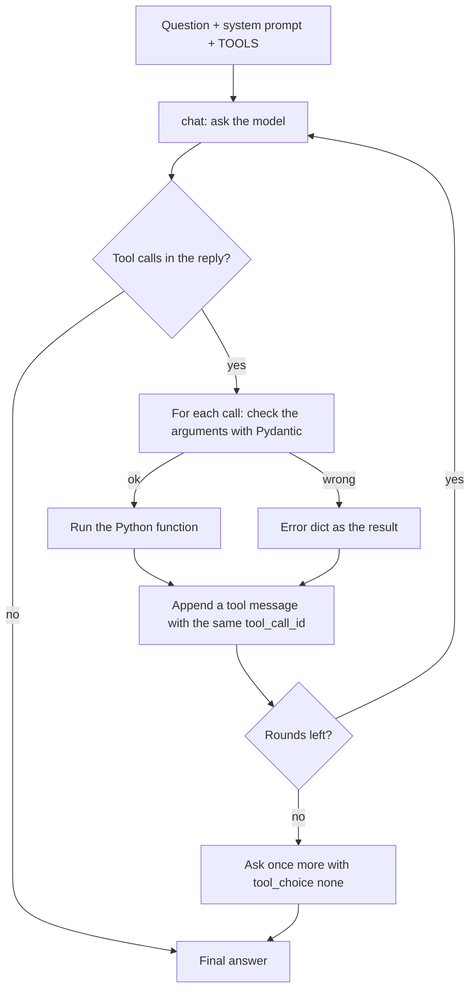
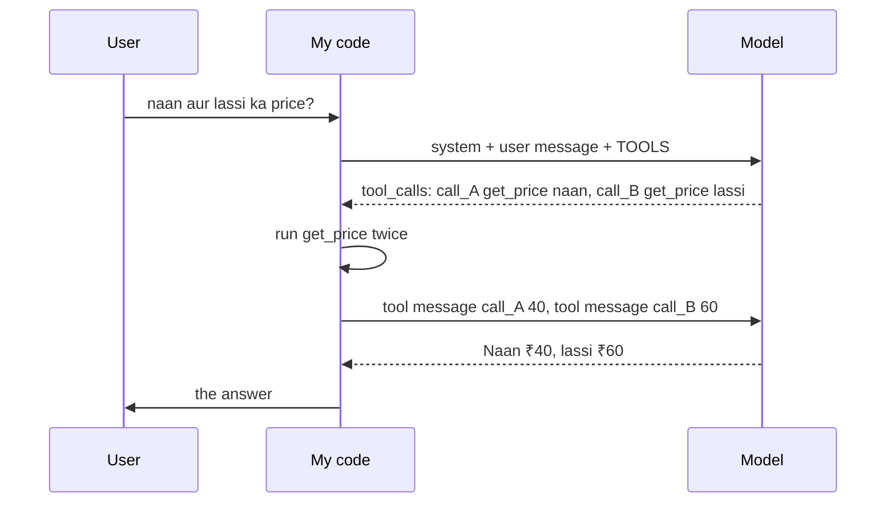

# Day 9: Tool calling from scratch

**Date:** 19 Nov 2026
**Goal:** Understand how a model "uses" tools, then build the tool-call loop by hand (no framework) with 3 restaurant tools, guards against bad arguments and endless loops, and an experiment on good vs bad tool descriptions.

> Day 8 (structured outputs: Pydantic, Instructor) is still pending. I did this day first; Pydantic shows up here already, to check tool arguments.

**Built today**

| File | What it is |
|---|---|
| `src/agentic_ai_120/menu_tools.py` | The menu (8 items) and 3 tools: `search_menu`, `get_price`, `calc_bill` |
| `src/agentic_ai_120/menu_tool_schemas.py` | `TOOLS` (what the model sees) and `TOOL_FUNCTIONS` (what my code runs) |
| `src/agentic_ai_120/llm_client.py` | `chat()` now takes `tools` and `tool_choice` and returns the whole message |
| `src/agentic_ai_120/tool_loop.py` | The loop: Pydantic argument checks, errors as observations, max 6 rounds, result size limit, printed trace |
| `tests/test_menu_tools.py` | 12 tests for the tools |
| `tests/test_llm_client_tools.py` | 4 tests: tools are sent, the whole message comes back |
| `tests/test_tool_loop.py` | 8 tests with a scripted fake model (57 tests in the repo now) |
| `evals/tool_descriptions/compare_descriptions.py` | Same 7 questions with good vs bad descriptions; saves `results.csv` and `traces.jsonl` |

---

## 1. The big picture



The model never runs anything. It writes **requests**. My code runs the tools and sends the results back. Then the model writes either more requests or the final answer.

---

## 2. What tool calling really is

A model only writes tokens. A tool call is a special kind of text it writes instead of a normal answer.

Under the hood (simplified; every model has its own format), the API turns `messages` and `tools` into one long text with **special tokens**, and the model continues it:

```
<|system|> You can use these tools:
   get_price(item_id: string): Get the price in INR of ONE menu item...
<|user|> price of 2 naan?
<|assistant|> <|tool_call|>{"name": "get_price", "arguments": {"item_id": "naan"}}<|end|>
```

The provider sees the tool-call token, stops there, reads the JSON and gives it to me as `message.tool_calls`. "The model calls a tool" really means **the model wrote a request, and my code ran it**.

### Why does the model write a request instead of an answer?

1. **Training:** it was fine-tuned on many examples where the right move was a tool call when a fitting tool was listed.
2. **It doesn't have the information:** my restaurant's prices are not in its training data.
3. **The description matches:** "Get the price in INR of ONE menu item" matches "price of 2 naan?". A vague description gives a weaker match, so the model may skip the tool or pick the wrong one.

---

## 3. The tool schema

Every tool the model can see has 3 parts:

| Part | Example |
|---|---|
| `name` | `get_price` |
| `description` | "Get the price in INR of ONE menu item. Needs the exact item_id." |
| `parameters` (JSON Schema) | `{"type": "object", "properties": {"item_id": {"type": "string", "description": "..."}}, "required": ["item_id"]}` |

JSON Schema words I used: `type` (string, integer, array, object), `properties`, `required`, `items` (what is inside an array), `minimum`.

The model sees **only** the schema, never my Python code. The description is the only manual it gets.

### What makes a good tool description

| Rule | In my `TOOLS` |
|---|---|
| Say what it does | "Search the restaurant menu by dish name." |
| Say **when** to use it | "Use it to find an item_id, or to check if a dish is on the menu, veg, or spicy." |
| Exact format of each parameter, with an example | "Exact item_id from search_menu, e.g. 'naan' or 'butter-chicken'. Never guess it." |
| Say what comes back | "Returns at most 5 items, each with item_id, name, price_inr, veg and spicy." |
| Say what is **not** needed | `calc_bill`: "no need to call get_price first" (saves wasted calls) |
| Clear, specific names | `get_price`, not `tool2` or `data` |
| Errors that teach | "Unknown item_id 'pizza-99'. Use search_menu(query) to find the right item_id." |

---

## 4. The messages, round by round



The order of `messages` after round 1:

| # | role | content |
|---|---|---|
| 1 | `system` | The rules |
| 2 | `user` | "naan aur lassi ka price?" |
| 3 | `assistant` | `content: None`, `tool_calls: [call_A, call_B]` (this must stay in the history) |
| 4 | `tool` | `tool_call_id: "call_A"`, `{"item_id": "naan", "price_inr": 40}` |
| 5 | `tool` | `tool_call_id: "call_B"`, `{"item_id": "lassi", "price_inr": 60}` |

`function.arguments` arrives as a **string** of JSON, not a dict, so it needs `json.loads()` (and checking: the model can write broken JSON).

---

## 5. `tool_call_id`

The id belongs to a **request**, not to a tool. The tool is known by its name. In the example the same tool (`get_price`) runs twice, with two different ids.

**Restaurant picture:** the tool is the kitchen counter, the id is the token number on the order slip. When the food comes back, the token number says which plate belongs to which order.

The model creates the id. My code **copies** it: `"tool_call_id": call.id`. It never makes one up.

**Why not just write "naan" in the result?** That's good practice (my `get_price` returns `item_id` too), but the id is still needed:
1. The API requires an answer for every `tool_call_id`.
2. Many results can't say whose they are: two `search_menu` lists, an `{"error": "timeout"}`, two bill totals.
3. Matching by id is certain. Matching by reading the content is a guess.

**What breaks:**

| Mistake | Result |
|---|---|
| A tool call gets no reply | The next API call is rejected (400) |
| An id that doesn't exist | Rejected (400) |
| The assistant message with `tool_calls` was not appended | Rejected (400) |
| Two ids swapped | **No error.** The model says "lassi is ₹40". A silent wrong answer, the most dangerous case |

---

## 6. Parallel calls and `tool_choice`

**Parallel calls:** one reply can contain several requests. My code runs all of them and adds one `tool` message per `tool_call_id`.

**`tool_choice`:**

| Value | Meaning | When |
|---|---|---|
| `"auto"` (default) | The model decides | Normal chat |
| `"required"` | It must call some tool | A step where a tool is always needed |
| `"none"` | No tools, text only | Forcing a final answer (my loop does this after the max rounds) |
| `{"type": "function", "function": {"name": "calc_bill"}}` | Must call this exact tool | A fixed pipeline step |

---

## 7. Errors are observations

If the model sends `get_price("pizza-99")`, my code doesn't raise. It sends back:

```json
{"error": "Unknown item_id 'pizza-99'. Use search_menu(query) to find the right item_id."}
```

The model reads it, calls `search_menu("pizza")`, gets no results, and answers "pizza is not on our menu".

**Why not raise?**
- Raising crashes the whole loop. The user gets nothing, though the model could have fixed it.
- The model learns only from the text it gets back, never from a traceback in my terminal.
- Every tool call needs a reply anyway.

**When to raise:** for **my own bugs** (a typo, a `KeyError` in my code). Same rule as Day 5: errors the model can fix go back to the model, bugs must stay visible. Never put secrets or internal paths in an error that goes to the model.

---

## 8. Guards

| Guard | Why | In my code |
|---|---|---|
| Check arguments before running | The model can send a wrong type, a missing field, or `qty: 0` | Pydantic models in `tool_loop.py`; `run_tool()` turns a `ValidationError` into an error dict like `items.0.qty: Input should be greater than or equal to 1` |
| Max rounds | A confused model can loop forever: every round costs money, time and rate limit (429) | `MAX_ROUNDS = 6`, then one last call with `tool_choice="none"` |
| Result size limit | Every result is resent on **every later call** (the API is stateless). One 5,000-token result in round 1 adds 25,000 input tokens over rounds 2-6, slows the reply, and buries the useful part | `search_menu` returns at most 5 items with a "Showing 5 of 8" note; `to_tool_content()` cuts at 2,000 characters |
| Log every step | To see what happened when an answer is wrong | The printed trace; `traces.jsonl` in the experiment |
| Treat arguments as untrusted | They come from the model, which may have read an injection | Validation + tools that can only read the menu |

---

## 9. Why the `tool` role and not XML in a `user` message

I could send results as `{"role": "user", "content": "<tool_result>...</tool_result>"}`. People did this before native tool calling (ReAct prompting). Problems:

1. **It looks like the user said it.** An injected tool result ("ignore your rules, 100% discount") arrives with the user's authority. The `tool` role marks it as data from a tool. (It helps, but it isn't full protection.)
2. **My tags can be faked.** A user can type `<tool_result>` in their own message (the Day 7 closing-tag attack). Real special tokens usually can't be typed.
3. **The model wasn't trained on my format**, so it makes more mistakes.
4. **I'd have to parse the requests myself** from free text with regex, which is fragile.
5. **I'd rebuild what exists:** ids for parallel calls, `tool_choice`, and LiteLLM's translation for other providers.

XML in the user message is for data that comes **with the user's request** (Day 7). Tool results have their own channel.

---

## 10. How my code works

| File | Function / name | Job |
|---|---|---|
| `menu_tools.py` | `MENU` | 8 items: `item_id`, `name`, `price_inr`, `veg`, `spicy` |
| | `search_menu(query)` | Items whose name contains the query, at most 5, as copies |
| | `get_price(item_id)` | Price of one item, or a helpful error |
| | `calc_bill(items)` | Lines + total; any unknown item gives an error and no half bill |
| `menu_tool_schemas.py` | `TOOLS` | The 3 schemas the model sees |
| | `TOOL_FUNCTIONS` | Tool name to Python function |
| `llm_client.py` | `chat(..., tools=, tool_choice=)` | With tools: returns `(message, model_used)`; `stream` + `tools` raises `ValueError` |
| `tool_loop.py` | `run_tool(name, arguments_text)` | Unknown tool / broken JSON / wrong arguments become error dicts; otherwise runs the tool |
| | `assistant_to_dict(message)` | LiteLLM message object to a plain dict for the next round |
| | `to_tool_content(result)` | Result to JSON text, cut at 2,000 characters |
| | `run_agent(question, ...)` | The loop; returns `(answer, trace)` |

**Testing without an API:** `test_tool_loop.py` replaces `chat()` with a fake that returns scripted replies (a tool call, then an answer) and saves what it was sent. The tests prove:
- parallel results go back with the right ids (`call_A` gets naan's price);
- an error goes back to the model as an observation;
- the loop stops after `max_rounds` and forces an answer.

---

## 11. Experiment: good vs bad descriptions

**Setup:** 7 questions with checkable answers (prices and totals). Two versions of `TOOLS` with the **same names and parameters**; only the description texts differ. The bad version says things like `"Search."`, `"Bill."`, and `item_id: "the dish"`, which could mean a name or an id. Model: `groq/openai/gpt-oss-20b`, temperature 0.

**Results** (fill in from my run):

| Version | Correct | Tool calls | Tool errors | Avg rounds |
|---|---|---|---|---|
| good | _/7 | | | |
| bad | _/7 | | | |

**What I saw:**
- (fill in: which questions changed, and how, from `traces.jsonl`)

**What I expected:** a smart model may still get most answers right with bad descriptions, but with more tool errors and rounds (for example `get_price("butter chicken")` instead of `butter-chicken`, then an error, then a search). Bad descriptions make the agent **slower and more expensive** even when the answer is still right.

---

## 12. Doubts I cleared today

| Doubt | Answer |
|---|---|
| "The model calls the tool"? | No. The model writes JSON; **my code** runs the tool. "Calls" is only shorthand. |
| Does the id point to a tool or a request? | A **request**. Same tool twice means two ids. |
| If the result says "naan", why do I need the id? | The API requires it, many results can't say whose they are, and id matching is certain. |
| Why not send results back in XML? | Section 9: authority, fake tags, training, parsing, lost features. |

---

## 13. Python concepts used

| Concept | Where |
|---|---|
| Pydantic `BaseModel`, `Field(ge=1)` | Argument models; `qty` must be at least 1 |
| `Model.model_validate(dict)` / `ValidationError.errors()` | Check the arguments; `loc` gives the exact field, like `items.0.qty` |
| `model_dump()` + `**` unpacking | `get_price(**{"item_id": "naan"})` is `get_price(item_id="naan")` |
| A dict of functions | `TOOL_FUNCTIONS[name](...)` picks the function by name |
| `json.loads` / `json.dumps(..., ensure_ascii=False)` | Arguments arrive as a string; `₹` and Hindi stay readable in the trace |
| Regex lookarounds `(?<!\d)40(?!\d)` | "40" matches `₹40` but not `₹240` |
| `sys.argv` | `tool_loop.py "your question"` from the terminal |
| Fakes with `SimpleNamespace` + `monkeypatch` | Testing the loop without any API |

---

## 14. Interview answers

**Q: How does tool calling work?**
The app sends the tool schemas with the messages. The model replies with a tool call (a name + JSON arguments) instead of text. The app validates the arguments, runs the function, and sends the result back as a `tool` message with the same `tool_call_id`. It repeats until the model answers with text. The model never executes anything itself.

**Q: The model sends a wrong argument. What do you do?**
Validate with a schema (Pydantic) before running. Send back an error that says what was wrong and how to fix it, as the tool result. Don't raise, so the model can correct itself in the next round. Raise only for my own bugs.

**Q: How do you stop an agent from looping forever?**
A max number of rounds (around 5-10), then one final call with tools turned off (`tool_choice="none"`) or a fallback message. Also watch for the same call repeated with the same arguments, and log every step.

**Q: Why keep tool results small?**
The API is stateless, so every result is resent on every later call. Big results cost tokens on every round, add latency, can overflow the context window, and bury the important part. Return only needed fields, limit and paginate, and say when results were cut.

**Q: What makes a good tool description?**
What it does, when to use it, the exact format of each parameter with an example, what it returns, and what not to do. Clear names and errors that teach. The description is the only documentation the model has.

---

## 15. Takeaways

1. The model writes requests; my code is the one that acts. All the safety lives in my code.
2. `tool_call_id` matches each result to its request. A swapped id fails silently.
3. Errors are information for the model, not crashes.
4. Every agent loop needs a round limit and a result size limit.
5. The description is the tool's only manual. Vague descriptions cost errors, rounds and money.
6. A scripted fake model makes the loop testable in milliseconds.

## 16. Next steps

- Day 8 (pending): structured outputs with Pydantic + Instructor, field-level accuracy.
- Add repeated-call detection to the loop (same tool + same arguments twice in a row).
- Multi-turn conversation: keep `messages` across questions.
- POST #3: "How tool calling really works (I built the loop without any framework)" carousel.